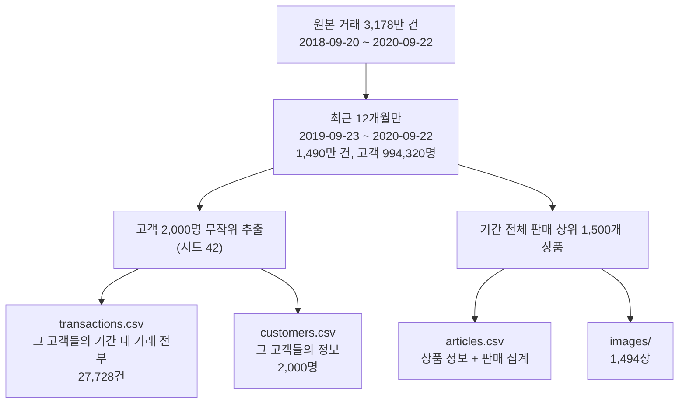

# A1-1 학습 정리 — 쇼핑몰 단골 찾기 (멀티모달 EDA·RFM)

이 문서는 [Subject.txt](Subject.txt)를 근거로 과제를 이해하고 직접 구현하기 위한 학습 노트다. 이 과제에는 `Evaluate.txt`가 없으므로, 평가에서 설명할 내용은 Subject 3장 「과제 목표」를 기준으로 정리한다. **보너스 과제는 제외한다.**

구현 순서와 완료 여부는 [CHECK.md](CHECK.md)에서 다룬다. 여기에서는 개념과 판단 기준을 익힌다. 아직 시작하지 않은 단계는 개념 요약만 두고, 해당 단계가 시작될 때 내용을 채운다.

## 1. 이 과제로 배울 것

**근거: Subject 1장 「미션 소개」, 3장 「과제 목표」**

이 과제는 모델을 학습시키는 과제가 아니다. 이후 컴퓨터 비전·자연어처리·머신러닝 과제의 바탕이 되는 **데이터를 숫자로 다루는 기초**를 익히는 과제다. Subject 7장은 Scikit-learn 같은 머신러닝 라이브러리를 오히려 금지한다.

| 핵심 키워드 | 과제에서 연결되는 작업 | 마친 뒤 설명할 수 있어야 할 내용 |
| --- | --- | --- |
| 멀티모달 데이터 | 수치·범주·날짜·텍스트·이미지를 한 분석 흐름에 모으기 | 서로 다른 종류의 데이터를 숫자 컬럼으로 바꿔 한 표에서 비교하는 방법 |
| NumPy 벡터 연산 | 이미지 평균·표준편차 계산 | 반복문 없이 배열 전체에 한 번에 계산하는 방법과 이점 (목표 1) |
| 이미지 통계 피처 | 이미지 → 숫자 2개(평균·표준편차) | 평균과 표준편차가 이미지의 무엇을 나타내는지 (목표 2) |
| 결측치 대치 | 그룹별 통계로 빈 값 채우기 | 전체 평균이 아니라 그룹 통계를 쓰는 이유 |
| IQR 이상치 탐지 | 직접 구현한 경계 계산과 처리 전후 비교 | Q1·Q3·IQR로 경계를 정하는 원리와 한계 (목표 3) |
| 탐색적 데이터 분석(EDA) | 기술 통계, 상관계수, 시각화 6종 | 숫자와 그래프로 데이터의 특징을 찾고 근거 있게 해석하는 방법 |
| RFM 세분화 | 고객을 4개 이상 그룹으로 나누기 | 최근성·빈도·금액으로 고객을 나누고 전략을 제안하는 과정 (목표 4) |
| OOP 파이프라인 | `DataAnalyzer` 클래스 | 분석 로직을 클래스로 묶어 다시 쓰기 쉽게 만드는 방법 (목표 5) |

## 2. 구현 범위와 제약

**근거: Subject 2장, 4장, 6장, 7장**

### 2-1. 제출물

| 경로 | 내용 |
| --- | --- |
| `src/pipeline.py` | `DataAnalyzer` 클래스. 원본 데이터를 받아 전처리·피처 엔지니어링·요약 통계를 수행한다. 필수 메서드는 `load_data()`, `handle_missing_values()`, `detect_outliers()`, `calculate_rfm()`이다. |
| `notebooks/analysis_report.ipynb` | 전처리 결과 시각화, 통계 분석, RFM 세분화 결과. 주요 분석 단계마다 마크다운 설명을 쓴다. |
| `README.md` | 프로젝트 개요, 데이터 설명, 비즈니스 인사이트 3가지 이상, 실행 방법 |

### 2-2. 사용할 수 있는 것과 없는 것

| 구분 | 내용 |
| --- | --- |
| 허용 | NumPy, Pandas, Matplotlib, Seaborn |
| 금지 | OpenCV·Pillow 등 이미지 처리 전용 라이브러리, Scikit-learn·NLTK 등 머신러닝·자연어처리 라이브러리, pandas-profiling·sweetviz 등 자동 EDA 라이브러리 |
| 이미지 처리 허용 범위 | 입력은 `imread()`로 읽은 NumPy 배열을 직접 조작한다. 리사이즈는 슬라이싱(`arr[::n, ::n]`)으로 단순 다운샘플링한다. |

`matplotlib.pyplot.imread()`는 PNG가 아닌 파일(우리 데이터의 JPG)을 읽을 때 내부적으로 Pillow를 사용한다. Subject 7장이 `imread()` 사용을 명시적으로 허용하므로 이것은 문제가 아니다. 금지되는 것은 코드에서 Pillow를 직접 불러와 이미지 처리를 맡기는 것이다.

### 2-3. 해석 작성 규칙

Subject 4장은 기본 탐색·통계 분석의 모든 해석에 **수치 근거 1개 이상 + 시사점 1문장 이상**을 요구한다. 예를 들면 다음과 같다(형식 예시이며 실제 수치가 아니다).

> 고객의 구매일 수 중앙값은 2일이고 75%가 5일 이하다(수치 근거). 대부분의 고객은 기간 중 몇 번만 방문하므로, 소수의 자주 오는 고객이 매출에서 차지하는 비중을 따로 확인해야 한다(시사점).

## 3. 데이터 준비

**근거: Subject 4장 「데이터 로드 및 기본 탐색」·「멀티 모달 데이터 피처 엔지니어링」·「RFM 기반 고객 세분화」, 7장 「데이터셋」**

이 장의 작업은 사용자 요청으로 Claude가 수행했다. 사용한 도구 `scripts/make_subset.py`, `scripts/download_images.py`는 Subject의 제출물이 아니다. 여기에서는 **왜 이 데이터를 골랐고, 왜 잘라 썼으며, 결과가 과제 요구를 어떻게 채우는지**를 이해하는 것이 목적이다.

### 3-1. 과제가 데이터에 요구하는 것

| 요구 | Subject 근거 |
| --- | --- |
| 1,000건 이상, 컬럼 8개 이상의 이커머스 데이터셋 | 4장 데이터 로드 |
| 수치형·범주형·날짜형·이미지(배열) 중 3가지 이상 | 4장 데이터 로드 |
| 상품 이미지 → 평균·표준편차 피처 | 4장 피처 엔지니어링 |
| 상품명 → 단어 수 또는 문자열 길이 피처 | 4장 피처 엔지니어링 |
| 거래 데이터에 `customer_id`, `order_date`, `amount`(또는 price×qty) | 4장 데이터 로드 (RFM) |
| 공개 라이선스 우선, 출처 명시 | 7장 데이터셋 |

핵심은 **상품 이미지**와 **고객별 거래 기록**이 모두 필요하다는 점이다. 이미지는 상품 쪽 데이터이고 RFM은 고객 쪽 데이터라서, 둘을 모두 가진 데이터셋을 찾는 것이 첫 과제였다.

### 3-2. 왜 Kaggle H&M 데이터인가

[Kaggle](https://www.kaggle.com)은 데이터 분석·머신러닝 대회와 공개 데이터셋을 모아 둔 사이트다. 사용한 데이터는 패션 기업 H&M이 2022년 대회용으로 공개한 [H&M Personalized Fashion Recommendations](https://www.kaggle.com/competitions/h-and-m-personalized-fashion-recommendations)다.

검토한 후보는 다음과 같다.

| 후보 | 상품 이미지 | 상품명 | 고객 거래 | 한계 |
| --- | --- | --- | --- | --- |
| **H&M (선택)** | 있음 | 있음 | 있음 | 원본이 매우 크다. 대회 규칙 동의가 필요하다. |
| UCI Online Retail II | 없음 | 있음 | 있음 | 이미지가 없어 이미지 피처 요구를 채울 수 없다. |
| Fashion Product Images | 있음 | 있음 | 없음 | 거래가 없어 RFM을 할 수 없다. |
| 위 두 개를 섞기 | 있음 | 있음 | 있음 | 서로 다른 회사의 상품이라 연결되지 않는다. 무관한 이미지를 상품에 붙이는 것은 가짜 연결이다. |

H&M은 상품(`articles.csv`), 고객(`customers.csv`), 거래(`transactions_train.csv`), 상품 이미지(`images/`)가 **같은 상품 ID(`article_id`)로 연결**된다. 그래서 이미지와 상품명 분석, 고객 RFM이 같은 가게의 같은 상품을 보게 된다. 요구사항 전체를 한 출처에서 채우는 후보는 이것뿐이었다.

라이선스는 CC-BY 같은 공개 라이선스가 아니라 대회 규칙을 따른다. Subject 7장의 "공개 라이선스 우선"은 권장 사항이므로, README에 출처와 사용 조건을 명시하는 방식으로 대응한다.

### 3-3. 왜 원본을 그대로 쓰지 않았나

원본 규모는 다음과 같다(직접 집계한 값).

| 원본 | 규모 |
| --- | --- |
| 거래 | 31,788,324건, 2018-09-20 ~ 2020-09-22, 파일 약 3.5GB |
| 고객 | 1,371,980명 |
| 상품 | 105,542개 |
| 이미지 | 105,100장, 수십 GB |

이것을 그대로 쓰면 다음 문제가 생긴다.

- 거래 3,000만 건을 한 번에 읽으면 메모리가 많이 필요하고 실행마다 몇 분씩 걸린다. 나눠 읽기 같은 대용량 처리 기술이 필요해지는데, 이것은 Subject가 요구하는 학습 목표가 아니다.
- 이미지를 모두 받으려면 수십 GB를 내려받아야 한다.
- Subject 4장의 요구는 **1,000건 이상**이다. 전체를 써야 한다는 요구는 없다.

그래서 **요구를 충분히 채우면서 노트북에서 바로 다룰 수 있는 크기로** 잘라 썼다. 같은 H&M 데이터를 잘라 쓰지 않고 전체로 처리한 사례도 있다. 그 경우 코드 대부분이 대용량 처리 기술에 쓰였다. 우리는 그 시간을 Subject의 핵심 개념에 쓰기로 했다.

### 3-4. 어떻게 잘랐나

**① 왜 12개월인가**

Recency(마지막 구매 후 지난 날수)의 최댓값은 분석 기간 길이로 정해진다.

| 기간 | Recency 범위 | 문제 |
| --- | --- | --- |
| 6개월 | 0 ~ 약 183일 | "오래전에 끊긴 고객"과 "잠깐 쉬는 고객"을 구분할 여유가 적다. |
| 12개월 | 0 ~ 365일 | 이탈 고객을 구분하기 충분하고, 월별 추이도 1년치를 볼 수 있다. |

실제 표본의 Recency는 0일부터 365일까지 퍼져 있고 중앙값은 87일이다.

**② 왜 고객은 "일부 고객의 거래 전부"인가**

고객을 먼저 고르고 그 고객의 거래를 **하나도 버리지 않아야** RFM이 정확하다. 반대로 상품을 먼저 고르고 그 상품의 거래만 남기면, 실제로 30번 산 고객이 고른 상품을 2번 샀을 때 F=2가 된다. 그 값은 그 고객의 진짜 구매 빈도가 아니다.

2,000명으로 정한 이유는 두 가지다. 4개 이상 그룹으로 나눠도 그룹마다 수백 명이 남아 비교할 수 있다. 거래도 27,728건으로 1,000건을 크게 넘는다. 무작위 추출에 시드 42를 고정해서, 스크립트를 다시 실행해도 같은 고객이 뽑힌다.

**③ 왜 상품은 "판매 상위 1,500개"인가**

처음에는 "표본 고객이 산 상품 전부"를 상품 테이블로 쓰려고 했다. 그런데 실제로 세어 보니 다음과 같았다.

- 2,000명이 산 상품이 **12,702종**이다. 이미지를 1만 장 넘게 받아야 한다.
- 그중 **53.1%가 딱 1번 팔린 상품**이다. 판매 1건짜리 상품으로는 가격·판매량 통계가 의미를 갖기 어렵다.

그래서 상품 테이블은 **같은 12개월 동안 전체 고객에게 가장 많이 팔린 1,500개**로 정했다. 각 상품은 기간 중 최소 1,675번 팔렸으므로 평균 가격과 판매량이 안정적인 숫자가 된다. 표본 고객 구매의 29.8%가 이 1,500개 상품에 해당한다. 두 테이블은 같은 가게, 같은 기간을 보지만 상품 분석과 고객 분석이 완전히 같은 상품 집합을 다루지는 않는다.

**④ 무엇을 손대지 않았나**

결측치와 이상치는 그대로 두었다. 5·6단계에서 직접 처리할 재료이기 때문이다. 바꾼 것은 RFM 컬럼 이름 두 개(`t_dat`→`order_date`, `price`→`amount`)뿐이고, 값은 원본과 같다.

### 3-5. 만들어진 파일과 컬럼

#### `data/transactions.csv` — 거래 1행 = 상품 1개 구매 (27,728행)

| 컬럼 | 뜻 | 자료형 |
| --- | --- | --- |
| `order_date` | 구매 날짜 (원본 `t_dat`) | 날짜 |
| `customer_id` | 고객 ID. 64자리 암호화 문자열 | 문자열 ID |
| `article_id` | 구매한 상품 ID | 문자열 ID |
| `amount` | 그 상품의 결제 금액 (원본 `price`). 상대값 | 수치 |
| `sales_channel_id` | 판매 채널 구분값 1 또는 2. 원본이 어느 쪽이 온라인인지 설명하지 않는다. | 범주 |

#### `data/customers.csv` — 고객 1행 = 고객 1명 (2,000행)

| 컬럼 | 뜻 | 결측 |
| --- | --- | --- |
| `customer_id` | 고객 ID | 0 |
| `FN` | 패션 뉴스 수신 관련 표시. 값은 1 또는 결측뿐이다. | 1,285 |
| `Active` | 활성 상태 표시. 값은 1 또는 결측뿐이다. | 1,296 |
| `club_member_status` | 회원 상태. `ACTIVE` 1,909명, `PRE-CREATE` 86명 | 5 |
| `fashion_news_frequency` | 뉴스 수신 빈도. `NONE` 1,254명, `Regularly` 716명, `Monthly` 1명 | 29 |
| `age` | 나이. 17~79세, 중앙값 31세 | 19 |
| `postal_code` | 우편번호. 암호화 문자열 | 0 |

`FN`과 `Active`의 결측이 "아니오"를 뜻하는지는 원본이 설명하지 않으므로 단정하지 않는다.

#### `data/articles.csv` — 상품 1행 = 상품 1개 (1,500행 × 29열)

| 컬럼 | 뜻 | 자료형 |
| --- | --- | --- |
| `article_id` | 상품 ID. 디자인 + 색상 단위다. | 문자열 ID |
| `product_code` | 디자인 단위 ID. 색상만 다른 상품은 같은 값을 가진다. 상품 1,500개의 디자인은 820종이다. | 문자열 ID |
| `prod_name` | 상품명. 예: `Jade HW Skinny Denim TRS`. 단어 수 1~6개 | 텍스트 |
| `product_type_name`, `product_group_name`, `colour_group_name`, `index_group_name`, `garment_group_name` 등 `_name` 컬럼 | 상품 종류·그룹·색상·대분류 등 | 범주 |
| `product_type_no`, `colour_group_code` 등 `_no`·`_code`·`_id` 컬럼 | 위 범주의 번호 | 범주 (숫자로 보이지만 수치가 아니다) |
| `detail_desc` | 상세 설명 | 텍스트, 결측 2 |
| `sales_count` | 분석 기간 동안 전체 고객에게 팔린 건수. 1,675 ~ 30,209 | 수치 |
| `avg_price` | 분석 기간 평균 판매가. 상대값 | 수치 |
| `first_sold_date` | 원본 거래 2년 안에서 처음 팔린 날짜 | 날짜 |
| `image_path` | 이미지 파일의 `data/` 기준 경로. 이미지가 없는 상품은 결측 | 문자열, 결측 6 |

#### `data/images/` — 상품 이미지 1,494장

- 파일 위치는 `data/images/<article_id 앞 3자리>/<article_id>.jpg`다.
- `imread()`로 읽으면 대부분 `(1750, 1166, 3)` 모양의 `uint8` 배열이다. 세로 1,750픽셀, 가로 1,166픽셀, 색 채널 3개(빨강·초록·파랑)이고, 각 값은 0~255다.
- 1,494장 중 1,488장이 이 크기다. 나머지 6장은 크기가 조금씩 다르다. 가로는 1,083 ~ 2,621픽셀이고, 1장은 세로가 1,749픽셀이다.

### 3-6. 각 테이블이 과제 요구를 어떻게 채우는가

| Subject 요구 | 채우는 데이터 |
| --- | --- |
| 1,000건 이상, 컬럼 8개 이상 (4장) | `articles.csv` 1,500행 × 29열, `transactions.csv` 27,728행 |
| 데이터 유형 3가지 이상 (4장) | 수치(`avg_price`, `sales_count`, `amount`, `age`), 범주(`product_group_name` 등), 날짜(`order_date`, `first_sold_date`), 이미지(jpg → 배열), 텍스트(`prod_name`) |
| 이미지 평균·표준편차 (4장) | `articles.csv`의 `image_path` → `data/images/` |
| 상품명 단어 수·문자열 길이 (4장) | `articles.csv`의 `prod_name` |
| 그룹별 결측치 대치 (4장) | 고객 `age` 결측 19건, 이미지 없는 상품 6개 등 실제 결측 |
| IQR 이상치 (4장) | `avg_price`, `sales_count`, `amount` 등 수치 컬럼 |
| 상관계수 2쌍 이상 (4장) | 이미지 피처·가격·판매량·상품명 피처 등 |
| 라인차트 시계열 (4장) | `transactions.csv`의 12개월 거래 |
| RFM 컬럼과 기준일 (4장) | `customer_id`, `order_date`, `amount`, 최종 거래일 2020-09-22 |
| 출처 명시 (7장) | Kaggle 대회 페이지 링크와 사용 조건을 README에 적는다. |

### 3-7. 이 데이터를 다룰 때 알아 둘 점

| 지점 | 내용 | 관련 단계 |
| --- | --- | --- |
| ID는 문자열 | `article_id`는 `0706016001`처럼 0으로 시작한다. 숫자로 읽으면 앞의 0이 사라져 이미지 경로나 다른 테이블과 연결이 끊긴다. | 1단계 |
| 금액은 상대값 | `amount`·`avg_price`는 원화나 달러가 아니다. H&M이 변환해 공개한 값이라 거래 금액 중앙값이 약 0.025다. "많다·적다", "몇 배"처럼 상대 비교로 해석한다. | 7·10·11단계 |
| 거래 1행 = 상품 1개 | 수량 컬럼이 없고 같은 날 여러 상품을 사면 여러 행이 된다. 고객·날짜 조합 중 68.3%가 2행 이상이다. Frequency를 행 수로 셀지 구매일 수로 셀지에 따라 결과가 크게 달라진다. | 9단계 (D8) |
| 첫 달과 마지막 달은 일부만 | 2019년 9월은 8일(863건), 2020년 9월은 22일(1,394건)만 들어 있다. 월별 합계에서 이 두 달이 작게 보이는 것은 판매 감소가 아니다. | 8단계 |
| 번호 컬럼은 범주 | `product_type_no` 같은 컬럼은 숫자지만 평균을 내면 의미가 없다. `describe()`에 함께 나오더라도 해석에서 구분한다. | 2·7단계 |
| 같은 이름, 다른 상품 | 색상만 다른 상품은 상품명이 같다. 상품명 피처가 같은 값으로 여러 번 나오는 이유다. | 3단계 |
| 이미지 크기가 조금씩 다르다 | 6장은 크기가 달라서, 여러 이미지를 하나의 배열로 쌓으려면 크기를 맞춰야 한다. | 4단계 (D4) |
| 실제 결측 | 이미지가 없는 상품 6개, 고객 `age` 19건 등. 다운로드 실패가 아니라 원본에도 없는 값이다. | 4·5단계 |

**스스로 설명해 보기**

1. 이미지가 없는 데이터셋 하나와 거래가 없는 데이터셋 하나를 합쳐 쓰지 않은 이유는 무엇인가?
2. 상품을 먼저 고르고 그 상품의 거래만 남겼다면 RFM의 어느 값이 어떻게 틀어지는가?
3. 분석 기간을 6개월로 줄였다면 Churned 같은 그룹을 정의하기가 왜 어려워지는가?
4. 상품 테이블과 거래 테이블이 완전히 같은 상품 집합이 아니라는 점은 해석에서 어떤 주의를 요구하는가?

## 4. 연산 비용 읽는 기준

**근거: Subject 3장 「과제 목표」 1, 4장 「멀티 모달 데이터 피처 엔지니어링」**

이 과제에서 비용을 판단할 때 기준이 되는 크기는 다음과 같다.

| 대상 | 크기 |
| --- | --- |
| 거래 행 수 | 27,728 |
| 고객 수 | 2,000 |
| 상품 수 | 1,500 |
| 이미지 1장의 값 개수 | 1,750 × 1,166 × 3 = 6,121,500 |

이미지 1장에만 600만 개가 넘는 값이 있다. 같은 계산이라도 Python 반복문으로 값을 하나씩 다루는 것과 NumPy가 배열 전체를 한 번에 처리하는 것은 속도 차이가 크다. 둘 다 값의 개수에 비례하는 일을 하지만, NumPy는 그 반복을 미리 컴파일된 코드 안에서 수행하기 때문이다. 자세한 내용은 4단계에서 다룬다.

## 5. 단계별 개념과 구현 단위

**근거: CHECK.md 1~11단계**

각 단계의 구현 단위 설명은 해당 단계를 시작할 때 이 장에 추가한다. 지금은 개념만 요약한다.

| 단계 | 개념 요약 |
| --- | --- |
| 1. 데이터 로드 | CSV를 DataFrame으로 읽기, 자료형 지정, 클래스에 상태 보관 |
| 2. 기본 탐색 | `info()`·`describe()`·`head()`로 구조 파악, 근거 있는 해석 쓰기 |
| 3. 텍스트 피처 | 문자열을 숫자 컬럼으로 바꾸기 |
| 4. 이미지 피처 | 이미지 = 숫자 배열, 축(axis)을 지정한 벡터 연산 |
| 5. 결측치 | 결측 현황 파악, GroupBy 통계로 대치 |
| 6. 이상치 | 사분위수와 IQR 경계, 처리 전후 분포 비교 |
| 7. 통계 분석 | 대표값과 퍼짐, 상관계수와 그 한계 |
| 8. 시각화 | 질문에 맞는 차트 고르기, 제목·축 레이블 |
| 9~10. RFM | 고객별 집계, 점수화, 규칙 기반 세분화 |
| 11. README | 근거·실행·검증을 갖춘 인사이트 쓰기 |

## 6. 평가에서 추가로 설명할 내용

**근거: Subject 3장 「과제 목표」**

`Evaluate.txt`가 없으므로 Subject 3장의 목표 5개를 기준으로, 구현이 끝나는 시점에 설명 자료를 정리한다. CHECK.md 14장이 해당 점검 항목이다.
