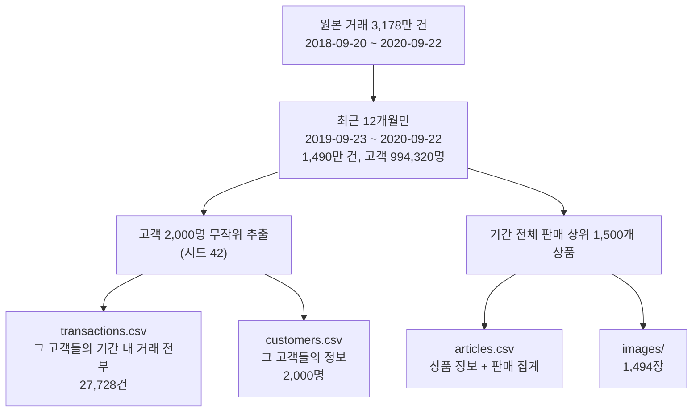

# A1-1 학습 정리 — 쇼핑몰 단골 찾기 (멀티모달 EDA·RFM)

이 문서는 [Subject.txt](Subject.txt)와 [Evaluate.txt](Evaluate.txt)를 근거로 과제를 이해하고, 설계를 토론해 Claude가 구현한 코드를 자신의 말로 설명할 수 있게 하기 위한 학습 노트다. Evaluate.txt의 문항에는 번호가 없어서, CHECK.md와 같이 항목 안의 순서대로 `평가 1-1`~`평가 4-3`으로 부른다. **보너스 과제는 제외한다.**

구현 순서와 완료 여부는 [CHECK.md](CHECK.md)에서 다룬다. 여기에서는 개념과 판단 기준을 익힌다. 아직 시작하지 않은 단계는 개념 요약만 두고, 해당 단계가 시작될 때 내용을 채운다.

이 과제는 Claude가 페이즈 단위로 구현하는 방식으로 진행한다(CHECK.md 0-4). 그래서 각 페이즈가 끝나면 이 문서에 **구현 설명** 절을 추가한다. 구현 설명은 "무엇을 만들었고 왜 그렇게 만들었는지", 실제 값으로 따라가 본 예, 경계 케이스, 평가에서 나올 질문을 담는다. 평가 항목 2~4는 사용자가 자기 코드를 설명하는 문항이므로, 구현 설명을 읽고 자신의 말로 설명할 수 있어야 CHECK.md 14단계를 체크한다.

## 1. 이 과제로 배울 것

**근거: Subject 1장 「미션 소개」, 3장 「과제 목표」 / 평가 항목 2~4**

이 과제는 모델을 학습시키는 과제가 아니다. 이후 컴퓨터 비전·자연어처리·머신러닝 과제의 바탕이 되는 **데이터를 숫자로 다루는 기초**를 익히는 과제다. Subject 7장은 Scikit-learn 같은 머신러닝 라이브러리를 오히려 금지한다.

| 핵심 키워드 | 과제에서 연결되는 작업 | 마친 뒤 설명할 수 있어야 할 내용 |
| --- | --- | --- |
| 멀티모달 데이터 | 수치·범주·날짜·텍스트·이미지를 한 분석 흐름에 모으기 | 서로 다른 종류의 데이터를 숫자 컬럼으로 바꿔 한 표에서 비교하는 방법 |
| NumPy 벡터 연산 | 이미지 평균·표준편차 계산 | 반복문 없이 배열 전체에 한 번에 계산하는 방법과 이점, 빠른 이유(연속 메모리·SIMD) (목표 1, 평가 2-2·3-4) |
| 이미지 통계 피처 | 이미지 → 숫자 2개(평균·표준편차) | 평균과 표준편차가 이미지의 무엇을 나타내는지 (목표 2) |
| 결측치 대치 | 그룹별 통계로 빈 값 채우기 | 전체 평균이 아니라 그룹 통계를 쓰는 이유와 그 위험(분산 축소, 그룹 간 차이 과장) (평가 3-2) |
| IQR 이상치 탐지 | 직접 구현한 경계 계산과 처리 전후 비교 | Q1·Q3·IQR로 경계를 정하는 원리, 효과적인 분포와 한계(정규 vs 비대칭) (목표 3, 평가 3-1) |
| 탐색적 데이터 분석(EDA) | 기술 통계, 상관계수, 시각화 6종 | 숫자와 그래프로 데이터의 특징을 찾고 근거 있게 해석하는 방법 |
| RFM 세분화 | 고객을 4개 이상 그룹으로 나누기 | 최근성·빈도·금액으로 고객을 나누고 전략을 제안하는 과정, 점수 기준을 그렇게 정한 이유 (목표 4, 평가 3-3) |
| OOP 파이프라인 | `DataAnalyzer` 클래스 | 분석 로직을 클래스로 묶어 다시 쓰기 쉽게 만드는 방법, 메서드를 나눈 이유와 파라미터를 인자로 받는 이유 (목표 5, 평가 2-1·2-3) |
| 확장 시나리오 | 구현이 끝난 뒤 설명하는 응용 질문 | 규모가 커졌을 때의 병목, 우선 캠페인 세그먼트와 리스크, 머신러닝으로 확장할 때의 타깃·피처 (평가 4-1~4-3. 기능을 추가 구현하라는 뜻이 아니다) |

## 2. 구현 범위와 제약

**근거: Subject 2장, 4장, 6장, 7장**

### 2-1. 제출물

| 경로 | 내용 |
| --- | --- |
| `src/pipeline.py` | `DataAnalyzer` 클래스. 원본 데이터를 받아 전처리·피처 엔지니어링·요약 통계를 수행한다. 필수 메서드는 `load_data()`, `handle_missing_values()`, `detect_outliers()`, `calculate_rfm()`이다. |
| `notebooks/analysis_report.ipynb` | 전처리 결과 시각화, 통계 분석, RFM 세분화 결과. 주요 분석 단계마다 마크다운 설명을 쓴다. |
| `README.md` | 프로젝트 개요, 데이터 설명, 비즈니스 인사이트 3가지 이상, 실행 방법 |

### 2-2. 사용할 수 있는 것과 없는 것

| 구분 | 내용 |
| --- | --- |
| 허용 | NumPy, Pandas, Matplotlib, Seaborn |
| 금지 | OpenCV·Pillow 등 이미지 처리 전용 라이브러리, Scikit-learn·NLTK 등 머신러닝·자연어처리 라이브러리, pandas-profiling·sweetviz 등 자동 EDA 라이브러리 |
| 이미지 처리 허용 범위 | 입력은 `imread()`로 읽은 NumPy 배열을 직접 조작한다. 리사이즈는 슬라이싱(`arr[::n, ::n]`)으로 단순 다운샘플링한다. |

`matplotlib.pyplot.imread()`는 PNG가 아닌 파일(우리 데이터의 JPG)을 읽을 때 내부적으로 Pillow를 사용한다. Subject 7장이 `imread()` 사용을 명시적으로 허용하므로 이것은 문제가 아니다. 금지되는 것은 코드에서 Pillow를 직접 불러와 이미지 처리를 맡기는 것이다.

### 2-3. 해석 작성 규칙

Subject 4장은 기본 탐색·통계 분석의 모든 해석에 **수치 근거 1개 이상 + 시사점 1문장 이상**을 요구하고, 평가 1-7도 기술통계와 상관분석 각각에 수치 근거와 시사점 해석이 있는지 확인한다. 예를 들면 다음과 같다(형식 예시이며 실제 수치가 아니다).

> 고객의 구매일 수 중앙값은 2일이고 75%가 5일 이하다(수치 근거). 대부분의 고객은 기간 중 몇 번만 방문하므로, 소수의 자주 오는 고객이 매출에서 차지하는 비중을 따로 확인해야 한다(시사점).

### 2-4. 의사결정 문서화

**근거: 평가 2-4, Subject 2장 「분석 리포트 노트북」(주요 분석 단계마다 마크다운 설명)**

평가 2-4는 노트북 마크다운에 "코드만으로는 파악하기 어려운 의사결정"이 적혀 있는지 본다. 코드는 **무엇을 했는지**를 보여 주지만 **왜 그렇게 정했는지**는 보여 주지 못한다. 그래서 CHECK.md 0장의 결정 기록표(D3~D8)에서 정한 선택은 이유와 함께 노트북에도 옮겨 적는다.

| 결정 | 노트북에 남길 것 | CHECK 단계 |
| --- | --- | --- |
| D3 텍스트 피처 | 단어 수와 문자열 길이 중 무엇을, 단어를 어떤 기준으로 나눠 썼는지와 이유 | 3 |
| D4 이미지 피처 | 다운샘플링 여부, 크기가 다른 이미지 처리, 이미지 없는 상품의 값과 이유 | 4 |
| D5 결측 대치 | 어떤 컬럼을 어떤 그룹의 어떤 통계로 채웠는지와 이유 | 5 |
| D6 이상치 | 임계값, 처리 방식(제거·대체·표시 등)과 이유 | 6 |
| D7 상관계수 | 어떤 변수 쌍을 어떤 단위로 계산했는지와 이유 | 7 |
| D8 RFM | Frequency 단위, 기준일, 점수 구간, 세그먼트 규칙과 이유 | 9·10 |

이유를 적을 때는 가능하면 데이터에서 본 수치를 함께 적는다. 형식 예시는 다음과 같다(실제 내용이 아니다).

> (결정) ○○ 컬럼의 결측을 △△ 그룹의 중앙값으로 채웠다. (이유) 그룹 간 중앙값이 ○○에서 ××만큼 차이 나서 전체 값 하나로 채우면 어긋난다. (영향) 대치 전후 결측 수가 ○에서 0으로 줄었다.

### 2-5. 파라미터를 인자로 받는 이유

**근거: 평가 2-3, Subject 4장 「분석 파이프라인 모듈화 (OOP)」, 8장 「Class 구조 예시」**

Subject 4장은 주요 파라미터(이상치 임계값, 결측치 대치 전략 등)를 메서드 인자로 받도록 설계하라고 하고, 평가 2-3은 여기에 RFM 기준일을 예로 더 든다. Subject 8장의 참고 예시(정답이 아니다)에서도 값이 인자로 들어가 있다.

| Subject 8장 예시 시그니처 | 인자로 받는 값 |
| --- | --- |
| `handle_missing_values(self, strategy='group_mean', group_col=None)` | 대치 전략, 그룹 컬럼 |
| `detect_outliers(self, column, threshold=1.5)` | 대상 컬럼, IQR 배수 |
| `calculate_rfm(self, customer_col, date_col, amount_col)` | 고객·날짜·금액 컬럼명 |

값을 코드 안에 박아 두었을 때와 인자로 받을 때의 차이는 다음 세 상황에서 드러난다.

| 상황 | 값이 코드 안에 박혀 있으면 | 인자로 받으면 |
| --- | --- | --- |
| 임계값을 1.5에서 3.0으로 바꿔 결과를 비교하고 싶을 때 | | |
| 컬럼 이름이 다른 데이터셋에 같은 클래스를 쓰고 싶을 때 | | |
| 분석 기준일을 바꿔 다시 계산하고 싶을 때 | | |

위 표의 빈 칸은 직접 채워 본다. 그리고 이 데이터셋에서 다른 데이터셋으로 옮길 때 바뀌어야 할 값이 무엇인지 목록으로 만들어 보면 평가 2-3의 "다른 데이터셋 적용 시 이점"을 설명하기 쉽다.

## 3. 데이터 준비

**근거: Subject 4장 「데이터 로드 및 기본 탐색」·「멀티 모달 데이터 피처 엔지니어링」·「RFM 기반 고객 세분화」, 7장 「데이터셋」**

이 장의 작업은 사용자 요청으로 Claude가 수행했다. 사용한 도구 `scripts/make_subset.py`, `scripts/download_images.py`는 Subject의 제출물이 아니다. 여기에서는 **왜 이 데이터를 골랐고, 왜 잘라 썼으며, 결과가 과제 요구를 어떻게 채우는지**를 이해하는 것이 목적이다.

### 3-1. 과제가 데이터에 요구하는 것

| 요구 | Subject 근거 |
| --- | --- |
| 1,000건 이상, 컬럼 8개 이상의 이커머스 데이터셋 | 4장 데이터 로드 |
| 수치형·범주형·날짜형·이미지(배열) 중 3가지 이상 | 4장 데이터 로드 |
| 상품 이미지 → 평균·표준편차 피처 | 4장 피처 엔지니어링 |
| 상품명 → 단어 수 또는 문자열 길이 피처 | 4장 피처 엔지니어링 |
| 거래 데이터에 `customer_id`, `order_date`, `amount`(또는 price×qty) | 4장 데이터 로드 (RFM) |
| 공개 라이선스 우선, 출처 명시 | 7장 데이터셋 |

핵심은 **상품 이미지**와 **고객별 거래 기록**이 모두 필요하다는 점이다. 이미지는 상품 쪽 데이터이고 RFM은 고객 쪽 데이터라서, 둘을 모두 가진 데이터셋을 찾는 것이 첫 과제였다.

### 3-2. 왜 Kaggle H&M 데이터인가

[Kaggle](https://www.kaggle.com)은 데이터 분석·머신러닝 대회와 공개 데이터셋을 모아 둔 사이트다. 사용한 데이터는 패션 기업 H&M이 2022년 대회용으로 공개한 [H&M Personalized Fashion Recommendations](https://www.kaggle.com/competitions/h-and-m-personalized-fashion-recommendations)다.

검토한 후보는 다음과 같다.

| 후보 | 상품 이미지 | 상품명 | 고객 거래 | 한계 |
| --- | --- | --- | --- | --- |
| **H&M (선택)** | 있음 | 있음 | 있음 | 원본이 매우 크다. 대회 규칙 동의가 필요하다. |
| UCI Online Retail II | 없음 | 있음 | 있음 | 이미지가 없어 이미지 피처 요구를 채울 수 없다. |
| Fashion Product Images | 있음 | 있음 | 없음 | 거래가 없어 RFM을 할 수 없다. |
| 위 두 개를 섞기 | 있음 | 있음 | 있음 | 서로 다른 회사의 상품이라 연결되지 않는다. 무관한 이미지를 상품에 붙이는 것은 가짜 연결이다. |

H&M은 상품(`articles.csv`), 고객(`customers.csv`), 거래(`transactions_train.csv`), 상품 이미지(`images/`)가 **같은 상품 ID(`article_id`)로 연결**된다. 그래서 이미지와 상품명 분석, 고객 RFM이 같은 가게의 같은 상품을 보게 된다. 요구사항 전체를 한 출처에서 채우는 후보는 이것뿐이었다.

라이선스는 CC-BY 같은 공개 라이선스가 아니라 대회 규칙을 따른다. Subject 7장의 "공개 라이선스 우선"은 권장 사항이므로, README에 출처와 사용 조건을 명시하는 방식으로 대응한다.

### 3-3. 왜 원본을 그대로 쓰지 않았나

원본 규모는 다음과 같다(직접 집계한 값).

| 원본 | 규모 |
| --- | --- |
| 거래 | 31,788,324건, 2018-09-20 ~ 2020-09-22, 파일 약 3.5GB |
| 고객 | 1,371,980명 |
| 상품 | 105,542개 |
| 이미지 | 105,100장, 수십 GB |

이것을 그대로 쓰면 다음 문제가 생긴다.

- 거래 3,000만 건을 한 번에 읽으면 메모리가 많이 필요하고 실행마다 몇 분씩 걸린다. 나눠 읽기 같은 대용량 처리 기술이 필요해지는데, 이것은 Subject가 요구하는 학습 목표가 아니다.
- 이미지를 모두 받으려면 수십 GB를 내려받아야 한다.
- Subject 4장의 요구는 **1,000건 이상**이다. 전체를 써야 한다는 요구는 없다.

그래서 **요구를 충분히 채우면서 노트북에서 바로 다룰 수 있는 크기로** 잘라 썼다. 같은 H&M 데이터를 잘라 쓰지 않고 전체로 처리한 사례도 있다. 그 경우 코드 대부분이 대용량 처리 기술에 쓰였다. 우리는 그 시간을 Subject의 핵심 개념에 쓰기로 했다.

### 3-4. 어떻게 잘랐나

**① 왜 12개월인가**

Recency(마지막 구매 후 지난 날수)의 최댓값은 분석 기간 길이로 정해진다.

| 기간 | Recency 범위 | 문제 |
| --- | --- | --- |
| 6개월 | 0 ~ 약 183일 | "오래전에 끊긴 고객"과 "잠깐 쉬는 고객"을 구분할 여유가 적다. |
| 12개월 | 0 ~ 365일 | 이탈 고객을 구분하기 충분하고, 월별 추이도 1년치를 볼 수 있다. |

실제 표본의 Recency는 0일부터 365일까지 퍼져 있고 중앙값은 87일이다.

**② 왜 고객은 "일부 고객의 거래 전부"인가**

고객을 먼저 고르고 그 고객의 거래를 **하나도 버리지 않아야** RFM이 정확하다. 반대로 상품을 먼저 고르고 그 상품의 거래만 남기면, 실제로 30번 산 고객이 고른 상품을 2번 샀을 때 F=2가 된다. 그 값은 그 고객의 진짜 구매 빈도가 아니다.

2,000명으로 정한 이유는 두 가지다. 4개 이상 그룹으로 나눠도 그룹마다 수백 명이 남아 비교할 수 있다. 거래도 27,728건으로 1,000건을 크게 넘는다. 무작위 추출에 시드 42를 고정해서, 스크립트를 다시 실행해도 같은 고객이 뽑힌다.

**③ 왜 상품은 "판매 상위 1,500개"인가**

처음에는 "표본 고객이 산 상품 전부"를 상품 테이블로 쓰려고 했다. 그런데 실제로 세어 보니 다음과 같았다.

- 2,000명이 산 상품이 **12,702종**이다. 이미지를 1만 장 넘게 받아야 한다.
- 그중 **53.1%가 딱 1번 팔린 상품**이다. 판매 1건짜리 상품으로는 가격·판매량 통계가 의미를 갖기 어렵다.

그래서 상품 테이블은 **같은 12개월 동안 전체 고객에게 가장 많이 팔린 1,500개**로 정했다. 각 상품은 기간 중 최소 1,675번 팔렸으므로 평균 가격과 판매량이 안정적인 숫자가 된다. 표본 고객 구매의 29.8%가 이 1,500개 상품에 해당한다. 두 테이블은 같은 가게, 같은 기간을 보지만 상품 분석과 고객 분석이 완전히 같은 상품 집합을 다루지는 않는다.

**④ 무엇을 손대지 않았나**

결측치와 이상치는 그대로 두었다. 5·6단계에서 직접 처리할 재료이기 때문이다. 바꾼 것은 RFM 컬럼 이름 두 개(`t_dat`→`order_date`, `price`→`amount`)뿐이고, 값은 원본과 같다.

### 3-5. 만들어진 파일과 컬럼

#### `data/transactions.csv` — 거래 1행 = 상품 1개 구매 (27,728행)

| 컬럼 | 뜻 | 자료형 |
| --- | --- | --- |
| `order_date` | 구매 날짜 (원본 `t_dat`) | 날짜 |
| `customer_id` | 고객 ID. 64자리 암호화 문자열 | 문자열 ID |
| `article_id` | 구매한 상품 ID | 문자열 ID |
| `amount` | 그 상품의 결제 금액 (원본 `price`). 상대값 | 수치 |
| `sales_channel_id` | 판매 채널 구분값 1 또는 2. 원본이 어느 쪽이 온라인인지 설명하지 않는다. | 범주 |

#### `data/customers.csv` — 고객 1행 = 고객 1명 (2,000행)

| 컬럼 | 뜻 | 결측 |
| --- | --- | --- |
| `customer_id` | 고객 ID | 0 |
| `FN` | 패션 뉴스 수신 관련 표시. 값은 1 또는 결측뿐이다. | 1,285 |
| `Active` | 활성 상태 표시. 값은 1 또는 결측뿐이다. | 1,296 |
| `club_member_status` | 회원 상태. `ACTIVE` 1,909명, `PRE-CREATE` 86명 | 5 |
| `fashion_news_frequency` | 뉴스 수신 빈도. `NONE` 1,254명, `Regularly` 716명, `Monthly` 1명 | 29 |
| `age` | 나이. 17~79세, 중앙값 31세 | 19 |
| `postal_code` | 우편번호. 암호화 문자열 | 0 |

`FN`과 `Active`의 결측이 "아니오"를 뜻하는지는 원본이 설명하지 않으므로 단정하지 않는다.

#### `data/articles.csv` — 상품 1행 = 상품 1개 (1,500행 × 29열)

| 컬럼 | 뜻 | 자료형 |
| --- | --- | --- |
| `article_id` | 상품 ID. 디자인 + 색상 단위다. | 문자열 ID |
| `product_code` | 디자인 단위 ID. 색상만 다른 상품은 같은 값을 가진다. 상품 1,500개의 디자인은 820종이다. | 문자열 ID |
| `prod_name` | 상품명. 예: `Jade HW Skinny Denim TRS`. 단어 수 1~6개 | 텍스트 |
| `product_type_name`, `product_group_name`, `colour_group_name`, `index_group_name`, `garment_group_name` 등 `_name` 컬럼 | 상품 종류·그룹·색상·대분류 등 | 범주 |
| `product_type_no`, `colour_group_code` 등 `_no`·`_code`·`_id` 컬럼 | 위 범주의 번호 | 범주 (숫자로 보이지만 수치가 아니다) |
| `detail_desc` | 상세 설명 | 텍스트, 결측 2 |
| `sales_count` | 분석 기간 동안 전체 고객에게 팔린 건수. 1,675 ~ 30,209 | 수치 |
| `avg_price` | 분석 기간 평균 판매가. 상대값 | 수치 |
| `first_sold_date` | 원본 거래 2년 안에서 처음 팔린 날짜 | 날짜 |
| `image_path` | 이미지 파일의 `data/` 기준 경로. 이미지가 없는 상품은 결측 | 문자열, 결측 6 |

#### `data/images/` — 상품 이미지 1,494장

- 파일 위치는 `data/images/<article_id 앞 3자리>/<article_id>.jpg`다.
- `imread()`로 읽으면 대부분 `(1750, 1166, 3)` 모양의 `uint8` 배열이다. 세로 1,750픽셀, 가로 1,166픽셀, 색 채널 3개(빨강·초록·파랑)이고, 각 값은 0~255다.
- 1,494장 중 1,488장이 이 크기다. 나머지 6장은 크기가 조금씩 다르다. 가로는 1,083 ~ 2,621픽셀이고, 1장은 세로가 1,749픽셀이다.

### 3-6. 각 테이블이 과제 요구를 어떻게 채우는가

| Subject 요구 | 채우는 데이터 |
| --- | --- |
| 1,000건 이상, 컬럼 8개 이상 (4장) | `articles.csv` 1,500행 × 29열, `transactions.csv` 27,728행 |
| 데이터 유형 3가지 이상 (4장) | 수치(`avg_price`, `sales_count`, `amount`, `age`), 범주(`product_group_name` 등), 날짜(`order_date`, `first_sold_date`), 이미지(jpg → 배열), 텍스트(`prod_name`) |
| 이미지 평균·표준편차 (4장) | `articles.csv`의 `image_path` → `data/images/` |
| 상품명 단어 수·문자열 길이 (4장) | `articles.csv`의 `prod_name` |
| 그룹별 결측치 대치 (4장) | 고객 `age` 결측 19건, 이미지 없는 상품 6개 등 실제 결측 |
| IQR 이상치 (4장) | `avg_price`, `sales_count`, `amount` 등 수치 컬럼 |
| 상관계수 2쌍 이상 (4장) | 이미지 피처·가격·판매량·상품명 피처 등 |
| 라인차트 시계열 (4장) | `transactions.csv`의 12개월 거래 |
| RFM 컬럼과 기준일 (4장) | `customer_id`, `order_date`, `amount`, 최종 거래일 2020-09-22 |
| 출처 명시 (7장) | Kaggle 대회 페이지 링크와 사용 조건을 README에 적는다. |

### 3-7. 이 데이터를 다룰 때 알아 둘 점

| 지점 | 내용 | 관련 단계 |
| --- | --- | --- |
| ID는 문자열 | `article_id`는 `0706016001`처럼 0으로 시작한다. 숫자로 읽으면 앞의 0이 사라져 이미지 경로나 다른 테이블과 연결이 끊긴다. | 1단계 |
| 금액은 상대값 | `amount`·`avg_price`는 원화나 달러가 아니다. H&M이 변환해 공개한 값이라 거래 금액 중앙값이 약 0.025다. "많다·적다", "몇 배"처럼 상대 비교로 해석한다. | 7·10·11단계 |
| 거래 1행 = 상품 1개 | 수량 컬럼이 없고 같은 날 여러 상품을 사면 여러 행이 된다. 고객·날짜 조합 중 68.3%가 2행 이상이다. Frequency를 행 수로 셀지 구매일 수로 셀지에 따라 결과가 크게 달라진다. | 9단계 (D8) |
| 첫 달과 마지막 달은 일부만 | 2019년 9월은 8일(863건), 2020년 9월은 22일(1,394건)만 들어 있다. 월별 합계에서 이 두 달이 작게 보이는 것은 판매 감소가 아니다. | 8단계 |
| 번호 컬럼은 범주 | `product_type_no` 같은 컬럼은 숫자지만 평균을 내면 의미가 없다. `describe()`에 함께 나오더라도 해석에서 구분한다. | 2·7단계 |
| 같은 이름, 다른 상품 | 색상만 다른 상품은 상품명이 같다. 상품명 피처가 같은 값으로 여러 번 나오는 이유다. | 3단계 |
| 이미지 크기가 조금씩 다르다 | 6장은 크기가 달라서, 여러 이미지를 하나의 배열로 쌓으려면 크기를 맞춰야 한다. | 4단계 (D4) |
| 실제 결측 | 이미지가 없는 상품 6개, 고객 `age` 19건 등. 다운로드 실패가 아니라 원본에도 없는 값이다. | 4·5단계 |

**스스로 설명해 보기**

1. 이미지가 없는 데이터셋 하나와 거래가 없는 데이터셋 하나를 합쳐 쓰지 않은 이유는 무엇인가?
2. 상품을 먼저 고르고 그 상품의 거래만 남겼다면 RFM의 어느 값이 어떻게 틀어지는가?
3. 분석 기간을 6개월로 줄였다면 Churned 같은 그룹을 정의하기가 왜 어려워지는가?
4. 상품 테이블과 거래 테이블이 완전히 같은 상품 집합이 아니라는 점은 해석에서 어떤 주의를 요구하는가?

## 4. 연산 비용 읽는 기준

**근거: Subject 3장 「과제 목표」 1, 4장 「멀티 모달 데이터 피처 엔지니어링」 / 평가 2-2, 3-4, 4-1**

이 과제에서 비용을 판단할 때 기준이 되는 크기는 다음과 같다.

| 대상 | 크기 |
| --- | --- |
| 거래 행 수 | 27,728 |
| 고객 수 | 2,000 |
| 상품 수 | 1,500 |
| 이미지 1장의 값 개수 | 1,750 × 1,166 × 3 = 6,121,500 |

이미지 1장에만 600만 개가 넘는 값이 있다. 같은 계산이라도 Python 반복문으로 값을 하나씩 다루는 것과 NumPy가 배열 전체를 한 번에 처리하는 것은 속도 차이가 크다. 둘 다 값의 개수에 비례하는 일을 하지만, NumPy는 그 반복을 미리 컴파일된 코드 안에서 수행하기 때문이다.

### 4-1. NumPy 벡터 연산이 빠른 이유

**근거: 평가 3-4(메모리 구조·SIMD 관점 설명), 평가 2-2, Subject 3장 「과제 목표」 1**

평가 3-4는 이 이유를 **연속 메모리 배치**와 **연산 방식(SIMD 등)** 관점에서 설명하라고 요구한다. 두 키워드의 세부 동작은 Subject·Evaluate 원문에 없는 일반 지식이다. 설명할 때 "반복문이 없어서 빠르다"가 아니라 "**반복이 Python 바깥의 컴파일된 코드와 연속 메모리 위에서 일어나서** 빠르다"로 말하는 것이 정확하다. 일의 양(값 하나하나를 처리하는 횟수)은 같고, 값 하나를 처리하는 데 드는 비용이 다르다.

| 관점 | Python 리스트 + 반복문 | NumPy 배열 연산 |
| --- | --- | --- |
| 값의 저장 | 리스트는 값 객체를 가리키는 참조를 담고, 값 객체는 메모리 여기저기에 놓인다. | 같은 자료형(dtype)의 값이 한 덩어리의 연속된 메모리에 나란히 놓인다. 이미지(`uint8`)는 값 하나가 1바이트다. |
| 값 하나를 처리할 때 | 반복마다 인터프리터가 명령을 해석하고, 값의 타입을 확인하고, 결과 객체를 새로 만든다. | 배열 전체의 타입이 하나로 정해져 있어 확인이 필요 없고, 미리 컴파일된 코드가 메모리를 한 번에 훑는다. |
| CPU 관점 | 값이 흩어져 있어 CPU 캐시를 활용하기 어렵다. | 연속된 값을 캐시 단위로 가져와 읽을 수 있다. 일부 연산은 SIMD로 한 명령에 여러 값을 처리한다. |

**SIMD**는 Single Instruction, Multiple Data의 약자로, 한 번의 CPU 명령이 여러 값에 같은 연산을 동시에 적용하는 방식이다. 예를 들어 256비트 레지스터에는 1바이트 값이 32개 들어가서 한 명령으로 32개를 한꺼번에 더할 수 있다. 같은 자료형이 연속으로 놓여 있어야 이 방식이 가능하다. NumPy가 실제로 SIMD를 쓰는지는 연산 종류, 자료형, CPU에 따라 다르며 모든 연산에서 쓰이는 것은 아니다.

**스스로 설명해 보기**

1. 이미지 평균을 Python 반복문으로 구할 때와 NumPy 배열 연산으로 구할 때, 값 하나를 처리하는 비용이 어디서 달라지는가?
2. 리스트가 값을 "참조"로 담는다는 점이 왜 SIMD 같은 방식을 막는가?

### 4-2. 크기 감각

**근거: 평가 4-1(규모 증가 시 병목), Subject 4장 「멀티 모달 데이터 피처 엔지니어링」**

평가 4-1은 이미지 해상도와 고객 수가 커졌을 때를 묻는다. 병목을 판단하려면 각 대상의 크기가 어떻게 계산되는지 알아야 한다. 아래는 직접 계산한 값이다(1MB = 1,000,000바이트로 어림).

| 대상 | 값 개수 | 저장 크기 |
| --- | --- | --- |
| 현재 이미지 1장 `(1750, 1166, 3)`, `uint8` | 6,121,500 | 약 6.1MB |
| 같은 이미지 배열을 `float64`로 바꿔 저장했을 때 | 6,121,500 | 약 49MB |
| 이미지 1장 `(1024, 1024, 3)`, `uint8` | 3,145,728 | 약 3.1MB |

이 표는 병목의 답이 아니라 계산 재료다. 4-1에 어떻게 답할지는 구현을 마친 뒤 6장의 관점으로 직접 정리한다.

## 5. 단계별 개념과 구현 단위

**근거: CHECK.md 1~11단계 / 평가 항목 1~3**

각 단계의 구현 단위 설명은 해당 단계를 시작할 때 이 장에 추가한다. 지금은 개념만 요약한다.

| 단계 | 개념 요약 |
| --- | --- |
| 1. 데이터 로드 | CSV를 DataFrame으로 읽기, 자료형 지정, 클래스에 상태 보관 |
| 2. 기본 탐색 | `info()`·`describe()`·`head()`로 구조 파악, 근거 있는 해석 쓰기 |
| 3. 텍스트 피처 | 문자열을 숫자 컬럼으로 바꾸기 |
| 4. 이미지 피처 | 이미지 = 숫자 배열, 축(axis)을 지정한 벡터 연산, 벡터 연산이 빠른 이유(4-1장) |
| 5. 결측치 | 결측 현황 파악, GroupBy 통계로 대치, 그룹 대치의 위험(분산 축소, 그룹 간 차이 과장), 선택 이유 문서화(2-4장) |
| 6. 이상치 | 사분위수와 IQR 경계, 처리 전후 분포 비교, IQR이 효과적인 분포와 한계(정규 vs 비대칭) |
| 7. 통계 분석 | 대표값과 퍼짐, 상관계수와 그 한계 |
| 8. 시각화 | 질문에 맞는 차트 고르기, 제목·축 레이블 |
| 9~10. RFM | 고객별 집계, 점수화(구간을 나누는 기준), 규칙 기반 세분화, 기준일을 인자로(2-5장) |
| 11. README | 근거·실행·검증을 갖춘 인사이트 쓰기 |

### 5-1. P1 구현 설명 — 뼈대와 `load_data()`

**대응: CHECK 1단계(1-1, 1-2) / Subject 4장 「데이터 로드 및 기본 탐색」·「분석 파이프라인 모듈화 (OOP)」 / 평가 1-1, 2-1, 2-3**

구현 위치는 [`src/pipeline.py`](../src/pipeline.py)와 [`notebooks/analysis_report.ipynb`](../notebooks/analysis_report.ipynb)다. 이 절의 설계는 모두 **내 설계 선택**이며 Subject가 정한 것이 아니다(Subject가 정한 것은 클래스 이름과 `load_data()`라는 메서드 이름, 분석 로직을 클래스로 구조화한다는 점뿐이다).

#### 무엇을 만들었나

| 구성 | 위치 | 하는 일 |
| --- | --- | --- |
| `DataAnalyzer(data_dir=None)` | pipeline.py:38 | 데이터 폴더를 기억하고 세 테이블 속성을 `None`으로 준비한다. 데이터는 아직 읽지 않는다. |
| `load_data()` | pipeline.py:55 | 세 CSV를 읽어 `self.transactions`, `self.customers`, `self.articles`에 저장하고 `self`를 반환한다. |
| 클래스 상수 | pipeline.py:23~36 | 파일 이름, 문자열로 읽을 ID 컬럼, 날짜로 읽을 컬럼을 한곳에 모은다. |
| 노트북 설정 셀 | notebook 2번째 셀 | 프로젝트 루트를 `sys.path`에 넣어 `from src.pipeline import DataAnalyzer`가 되게 한다. |

`__init__`과 `load_data()`를 나눈 이유는 "분석기를 만드는 일"과 "파일을 읽는 일"의 책임이 다르기 때문이다. 생성자는 가볍게 끝나고, 읽기는 필요할 때 명시적으로 부르며, 다시 부르면 처음 상태로 되돌아간다. 뒤 페이즈에서 테이블에 컬럼을 추가한 뒤 원상복구가 필요하면 `load_data()`를 다시 호출하면 된다.

#### 실제 값으로 따라가기

| 호출 | 일어나는 일 | 결과 |
| --- | --- | --- |
| `DataAnalyzer()` | `data_dir`이 `None`이므로 `pipeline.py` 위치에서 두 단계 위(프로젝트 루트) + `data`를 계산한다(47줄). | `analyzer.data_dir` = `.../A1-1/data`, 세 테이블은 `None` |
| `.load_data()` | 세 파일 존재를 확인한 뒤(69~83줄) 각각 `read_csv`로 읽는다. | 거래 27,728×5, 고객 2,000×7, 상품 1,500×29 |
| 반환 | `return self`(99줄) | `analyzer = DataAnalyzer().load_data()`처럼 한 줄로 쓸 수 있다. |

`Path(__file__).resolve().parents[1]`에서 `parents[0]`은 `src/`, `parents[1]`은 프로젝트 루트다. 작업 폴더가 아니라 **파일 위치**를 기준으로 하므로, 노트북이 `notebooks/`에서 실행돼도 `data/`를 찾는다.

#### 경계 케이스

| 상황 | 기대 결과 | 확인 |
| --- | --- | --- |
| `load_data()` 호출 전 | 세 테이블이 `None` | 확인함 |
| 존재하지 않는 `data_dir` | 없는 파일 이름과 `make_subset.py` 안내를 담은 `FileNotFoundError` | 확인함 |
| `load_data()`를 두 번 호출 | 파일에서 새로 읽는다. 중간에 붙인 컬럼이 사라진다. | 확인함 |
| `data_dir`에 문자열을 줌 | `Path`로 바꿔 사용한다. | 확인함 |

#### 헷갈리기 쉬운 구분

- **ID는 숫자가 아니라 이름표다.** `0706016001`을 정수로 읽으면 `706016001`이 되어 앞자리 0이 사라지고, 이미지 경로(`images/070/0706016001.jpg`)와 다른 테이블의 같은 ID와 맞지 않게 된다. 그래서 `dtype`으로 문자열을 지정했다(30~32줄). 이 데이터의 `article_id`는 1,500개 모두 길이 10에 앞자리가 0이다.
- **날짜는 문자열이 아니라 날짜형으로 읽는다.** 그래야 뒤에서 `최댓값 - 날짜`로 Recency 같은 날짜 계산을 할 수 있다. pandas 3.x에서는 `datetime64[us]`로 나온다.
- **`read_csv`의 `dtype`과 `parse_dates`는 역할이 다르다.** `dtype`은 값을 어떤 자료형으로 읽을지, `parse_dates`는 어떤 컬럼을 날짜로 해석할지 지정한다.
- **이 단계에서는 값을 고치지 않는다.** 결측과 이상치는 그대로이고, 번호 컬럼(`product_type_no` 등)의 자료형 판단은 P2로 미뤘다.

#### 구현 후 확인한 상태

스크립트 20개 확인(크기, ID 길이와 `0706016001` 유지, 날짜 범위, 재호출, 오류 경로 등)이 모두 통과했고, `.venv`의 Jupyter로 노트북을 처음부터 끝까지 실행해 오류가 없었다. 노트북 출력은 거래 27,728행 × 5열, 고객 2,000행 × 7열, 상품 1,500행 × 29열, `order_date` 범위 2019-09-23 ~ 2020-09-22다.

#### 스스로 설명해 보기

1. `DataAnalyzer`가 데이터를 읽고 계산만 하며 차트를 그리지 않는 이유는 무엇인가? (평가 2-1)
2. `data_dir`을 인자로 받고 기본값을 파일 위치 기준으로 계산한 이유와, 이 설계가 다른 데이터셋에 적용할 때 주는 이점은? (평가 2-3)
3. `article_id`를 문자열로 읽지 않으면 어떤 값이 어떻게 달라지고, 그 결과 어느 단계가 깨지는가?
4. `load_data()`가 `self`를 반환하면 노트북에서 무엇이 편해지는가?

### 5-2. P2 구현 설명 — 기본 탐색과 해석

**대응: CHECK 2단계 / Subject 4장 「데이터 로드 및 기본 탐색」 / 평가 1-3, 1-7(해석 형식), 2-4(의사결정 문서화)**

구현 위치는 [`notebooks/analysis_report.ipynb`](../notebooks/analysis_report.ipynb)의 2장(2-1 거래, 2-2 고객, 2-3 상품, 2-4 데이터 구조 점검)이다. **`src/pipeline.py`는 바꾸지 않았다.** `head()`, `info()`, `describe()`는 pandas가 이미 제공하는 기능이라 클래스에 넣을 분석 로직이 없기 때문이다. 이 절의 분류와 결정은 모두 내 설계 선택이다.

#### 세 가지 도구 읽는 법

| 도구 | 보여 주는 것 | 읽는 법 |
| --- | --- | --- |
| `head()` | 앞 5행 | 컬럼이 어떤 값으로 채워져 있는지 눈으로 확인한다. |
| `info()` | 컬럼 이름, 비어 있지 않은 값의 개수(Non-Null Count), 자료형(Dtype) | Non-Null Count가 전체 행 수보다 작으면 그 차이만큼 **결측**이다. |
| `describe()` | 수치 컬럼의 개수(count), 평균(mean), 표준편차(std), 최솟값, 25%·50%·75%, 최댓값 | 50%가 중앙값이다. 25%·75%는 줄 세운 값의 1/4, 3/4 지점이다. |

**평균과 중앙값을 같이 본다.** 평균은 큰 값 몇 개에 끌려가지만 중앙값은 그렇지 않다. 그래서 평균이 중앙값보다 훨씬 크면 "오른쪽으로 긴 꼬리"가 있다는 신호다. 6단계 이상치 탐지가 이 꼬리를 다룬다.

#### 실제 값으로 따라가기

| 보는 곳 | 출력 | 읽은 내용 |
| --- | --- | --- |
| 고객 `info()`의 `age` | Non-Null Count 1981, 전체 2000 | 2000 − 1981 = 19명이 결측 |
| 고객 `describe()`의 `age` | count 1981, mean 35.65, 25% 24, 50% 31, 75% 48 | 절반이 31세 이하이고 평균이 더 높아 나이 많은 쪽으로 꼬리가 길다. |
| 거래 `describe()`의 `amount` | mean 0.0281, 50% 0.0254, max 0.3373 | 평균 > 중앙값이고, 최댓값은 중앙값의 약 13.3배 |
| 상품 `sales_count` | 중앙값 2,387, 최댓값 30,209 | 최댓값이 중앙값의 약 12.7배 → 소수 베스트셀러 쏠림 |

#### 이 단계에서 내린 결정과 이유 (D9, 평가 2-4)

코드만으로는 알 수 없는 결정은 노트북 마크다운에 적었다.

- **8컬럼 기준은 상품 테이블로 확인한다.** Subject는 "8개 이상의 컬럼을 가진 데이터셋"을 요구한다. 거래는 5열, 고객은 7열이라 각각은 못 미치고, 상품 테이블만 29열로 충족한다. 세 테이블을 합친 표를 만들지 않고 상품 테이블을 기준으로 읽었다(원문이 어느 테이블을 가리키는지 밝히지 않아서 내린 해석이다).
- **번호 컬럼은 자료형을 바꾸지 않고 노트북에서 분류한다.** `product_type_no` 같은 9개 컬럼은 정수지만 "종류 번호"다. 고유값이 4~82개뿐이고 1,500행에 반복된다. 평균을 내도 의미가 없으므로 해석에서 제외한다. `load_data()`에서 자료형을 바꾸면 P5의 그룹 대치 등에서 신경 쓸 것이 늘어나서 지금은 바꾸지 않았다.
- **컬럼 분류 기준.** 수치형은 크기를 비교할 수 있는 값(`amount`, `age`, `sales_count`, `avg_price`), 범주형은 종류를 가르는 값(번호 컬럼, `sales_channel_id`, `FN`·`Active`, 이름 컬럼 등)이다. 상품 테이블은 수치형 2, 날짜형 1, 텍스트 2, 이미지 경로 1, ID 2, 범주형 21이다.
- **이미지 유형은 경로 개수만 보인다.** 이미지를 배열로 바꾸는 것은 4단계에서 한다. "데이터 유형 3종 이상"은 수치·범주·날짜로 이미 충족한다.

#### 헷갈리기 쉬운 구분

- **숫자로 저장됐다고 수치가 아니다.** 번호 컬럼, `sales_channel_id`(값 1과 2), `FN`·`Active`(값 1)는 숫자 자료형이지만 평균을 내는 대상이 아니다.
- **결측을 0이나 "아니오"로 단정하지 않는다.** `FN`·`Active`의 결측이 무엇을 뜻하는지 원본이 설명하지 않으므로, 의미를 알기 전에는 분석 변수로 쓰지 않는다.
- **금액은 상대값이다.** `amount`는 원화나 달러가 아니라서 "몇 원"이 아니라 "다른 거래와의 비율"로 해석한다.
- **해석에는 수치와 시사점이 모두 있어야 한다.** "평균이 높다"는 수치 없는 말이고, "평균이 0.0281이다"는 시사점 없는 말이다. 두 가지를 짝지어 쓴다.

#### 구현 후 확인한 상태

노트북을 처음부터 끝까지 실행해 오류가 없었다. 해석에 쓴 수치는 같은 장 셀의 출력과 대조했고, 원본 CSV에서 pandas 없이 다시 계산한 값과도 맞았다(거래 27,728건, `amount` 평균 0.0281·중앙값 0.0254·최댓값 0.3373, `age` 1,981명·중앙값 31·평균 35.65, `sales_count` 중앙값 2,387·최댓값 30,209, 이미지 경로 결측 6개).

#### 스스로 설명해 보기

1. `info()` 출력에서 결측이 있는 컬럼을 어떻게 알아보는가?
2. `amount`의 평균 0.0281, 중앙값 0.0254, 최댓값 0.3373을 보고 분포가 어떤 모양이라고 할 수 있는가? 그것이 왜 금액 해석에 영향을 주는가?
3. `product_type_no`의 평균을 구하면 안 되는 이유는 무엇인가?
4. 8컬럼 기준을 상품 테이블로 확인한 이유는 무엇이고, 그 판단은 Subject의 요구인가 내 해석인가?
5. `FN`의 빈 값을 0으로 채우지 않은 이유는 무엇인가?

### 5-3. P3 구현 설명 — 텍스트 파생 변수

**대응: CHECK 3단계 / Subject 4장 「멀티 모달 데이터 피처 엔지니어링」 텍스트 데이터 / 평가 1-4, 2-3, 2-4**

구현 위치는 [`src/pipeline.py`](../src/pipeline.py)의 `add_text_features()`(101줄)와 노트북 3장이다. Subject가 정한 것은 "상품명에서 단어 수 또는 문자열 길이를 계산해 새 컬럼으로 추가한다"까지이고, 아래 설계(둘 다 만들기, 이름 규칙, 단어 나누는 기준)는 모두 내 설계 선택이다.

#### 왜 문자열을 숫자로 바꾸는가

상품명 `Jade HW Skinny Denim TRS`는 글자라서 평균을 내거나 가격과 상관계수를 구할 수 없다. 그래서 글자의 특징을 숫자로 뽑는다. 단어가 몇 개인지(5), 글자가 몇 개인지(24)는 숫자라서 다른 컬럼과 같은 표에서 계산할 수 있다. 이것이 멀티모달 데이터를 한 분석 흐름에 모으는 가장 단순한 예다. 이미지에서 평균·표준편차를 뽑는 4단계도 같은 생각이다.

#### 무엇을 만들었나

| 구성 | 위치 | 하는 일 |
| --- | --- | --- |
| `add_text_features(text_col="prod_name")` | pipeline.py:101 | 대상 텍스트 컬럼을 받아 단어 수와 글자 수 컬럼 2개를 `self.articles`에 추가하고 `self`를 반환 |
| 단어 수 `{text_col}_word_count` | pipeline.py:126 | `text.str.split().str.len()` |
| 글자 수 `{text_col}_length` | pipeline.py:127 | `text.str.len()` |
| 호출 전 확인 | pipeline.py:122 | `load_data()` 전이면 `RuntimeError` |

컬럼 이름을 인자에서 만들기 때문에 `text_col="detail_desc"`로 부르면 `detail_desc_word_count`, `detail_desc_length`가 생긴다. 같은 메서드를 다른 텍스트 컬럼이나 다른 데이터셋에 쓸 수 있고, 이것이 평가 2-3이 묻는 "파라미터를 인자로 받는 이유"의 한 예다.

#### 실제 값으로 따라가기

| 상품명 | `split()` 결과 | 단어 수 | 글자 수 |
| --- | --- | --- | --- |
| `Mona` | `['Mona']` | 1 | 4 |
| `Tilly (1)` | `['Tilly', '(1)']` | 2 | 9 (`Tilly` 5 + 공백 1 + `(1)` 3) |
| `Jade HW Skinny Denim TRS` | 5조각 | 5 | 24 |
| `Maja HW  WovenTRS` (`HW` 뒤 공백 2개) | `['Maja', 'HW', 'WovenTRS']` | 3 | 17 |

`.str.split().str.len()`은 두 단계다. 먼저 각 상품명을 조각 목록으로 나누고(문자열 → 목록), 그 목록의 길이를 센다(목록 → 숫자). 글자 수는 목록이 아니라 문자열 자체의 길이다.

#### 경계 케이스

| 상황 | 결과 | 확인 |
| --- | --- | --- |
| 공백이 연속된 상품명(11개, 이름 6종) | `split()`은 연속 공백을 하나로 보므로 3단어. `split(' ')`이면 빈 조각이 생겨 4단어 | 확인함 |
| 구두점(`Tilly (1)`, `2-pack`, `Bradley.`) | 정리하지 않고 공백으로 나뉜 조각을 단어로 센다 | 확인함 |
| 1단어 상품명(251개) | 단어 수 1 | 확인함 |
| `load_data()` 전에 호출 | `RuntimeError` | 확인함 |
| 같은 메서드를 두 번 호출 | 같은 컬럼을 덮어써서 결과와 열 수(31) 동일 | 확인함 |
| 결측 텍스트(`detail_desc`의 2개) | 두 컬럼도 결측(0이 아님). 이때 컬럼 자료형은 정수가 아니라 실수가 된다. | 확인함 |
| 없는 컬럼 이름 | pandas가 `KeyError` | 확인함 |

#### 헷갈리기 쉬운 구분

- **`split()`과 `split(' ')`은 다르다.** 인자 없는 `split()`은 공백이 몇 개든 하나의 구분자로 본다. 이 데이터에서 11개 상품이 이 차이로 단어 수가 달라진다.
- **단어 수와 글자 수는 서로 다른 정보지만 같이 움직인다.** 단어가 많으면 글자도 많아서 두 값의 상관이 높다(직접 계산한 값은 약 0.89). 상관행렬을 볼 때(7단계) 두 피처가 비슷한 정보를 담고 있다는 점을 감안한다.
- **같은 이름이 반복된다.** 상품 1,500개의 고유한 상품명은 854개다. 색상만 다른 상품은 이름이 같아서 같은 값이 여러 번 나온다.
- **이 단계의 "반복문 없음"은 4단계의 NumPy 연산과 다르다.** 여기서 반복을 대신하는 것은 pandas의 문자열 메서드이고, 내부에서 값마다 파이썬 문자열 함수를 부른다. 숫자 배열을 연속 메모리에서 한꺼번에 처리하는 NumPy 벡터 연산(평가 3-4)만큼 빠르지는 않다. 평가 2-2의 "for 대신 NumPy 배열 연산을 쓴 곳"은 4단계의 이미지 피처 코드이므로 이 메서드를 가리키지 않는다.

#### 복잡도

모든 상품명을 한 번씩 훑으므로 전체 시간은 상품 수와 이름 길이에 비례한다(상품 1,500개, 이름 평균 약 15글자). 데이터가 커지면 그만큼 시간이 늘지만 이 규모에서는 순식간이다.

#### 구현 후 확인한 상태

1,500행 전부를 원본 CSV에서 순수 파이썬 반복문으로 따로 계산한 값과 새 컬럼이 일치했다. 손으로 센 6개 값도 일치했고, 노트북 출력은 단어 수 평균 2.75·글자 수 평균 15.54, 고유 상품명 854개, 행 × 열 1,500 × 31이다.

#### 스스로 설명해 보기

1. 상품명을 숫자 컬럼으로 바꾸는 이유는 무엇이고, 단어 수와 글자 수 중 하나만 써도 되는데 둘 다 만든 이유는 무엇인가?
2. `split()`과 `split(' ')`은 어떤 상품명에서 다른 결과를 내는가? 이 데이터에서 몇 개 상품이 그런가?
3. `text_col`을 인자로 받아 컬럼 이름을 파생시킨 설계는 다른 데이터셋에 적용할 때 어떤 이점이 있는가? (평가 2-3)
4. 이 메서드가 반복문 없이 계산한다는 것과 4단계 이미지 피처의 "NumPy 배열 연산"은 어떻게 다른가?

### 5-4. P4 구현 설명 — 이미지 피처 (NumPy 배열 연산)

**대응: CHECK 4단계 / Subject 3장 「과제 목표」 1·2, 4장 「멀티 모달 데이터 피처 엔지니어링」 이미지 데이터, 7장 「이미지 처리 허용 범위 가이드」 / 평가 1-4, 2-2, 3-4**

구현 위치는 [`src/pipeline.py`](../src/pipeline.py)의 `add_image_features()`(132줄), `_image_mean_std()`(180줄)와 노트북 4장이다. Subject가 정한 것은 "이미지의 평균과 표준편차를 새 컬럼으로 추가하고, 반복문 대신 배열 연산을 쓴다"까지이고, 아래 설계(이미지 전체 값으로 하나씩 계산, `step` 인자, 한 장씩 계산하기 등)는 내 설계 선택이다.

#### 이미지는 숫자 배열이다

컴퓨터에게 이미지는 사진이 아니라 숫자가 격자로 놓인 배열이다. 이 데이터의 이미지 한 장은 `(세로, 가로, 채널)` 모양이다.

| 축 | 의미 | 샘플 이미지 `0706016001` |
| --- | --- | --- |
| 세로 | 위에서 아래로 몇 줄인가 | 1,750 |
| 가로 | 왼쪽에서 오른쪽으로 몇 칸인가 | 1,166 |
| 채널 | 한 칸의 색을 이루는 값의 개수(빨강·초록·파랑) | 3 |

각 칸의 값은 `uint8`(0~255의 정수)이고, 0이 가장 어둡고 255가 가장 밝다. 전체 값의 개수는 1,750 × 1,166 × 3 = 6,121,500개다.

**평균과 표준편차가 말하는 것.** 이미지 전체 값의 평균은 이미지의 밝기, 표준편차는 밝고 어두운 부분이 얼마나 갈리는지(대비)다. 아주 작은 예로 값이 `[10, 20, 30, 40]`이면 평균은 25이고, 각 값과 평균의 차이 제곱의 평균은 (225 + 25 + 25 + 225) / 4 = 125이므로 표준편차는 √125 ≈ 11.18이다. 값이 `[25, 25, 25, 25]`이면 표준편차는 0이다. 아무것도 다르지 않은 이미지(단색)는 대비가 0이다.

**표준편차의 `ddof`.** 위처럼 나누는 수를 값의 개수(4)로 하면 모집단 표준편차(NumPy 기본값, `ddof=0`)이고, 개수 − 1(3)로 나누면 표본 표준편차(pandas 기본값, `ddof=1`)로 √(500/3) ≈ 12.91이다. 이미지의 모든 픽셀을 다 가지고 있어서 모집단 값이 맞다고 보고 NumPy 기본값을 썼다. 같은 값을 pandas로 구하면 다른 값이 나올 수 있다.

#### 무엇을 만들었나

| 구성 | 위치 | 하는 일 |
| --- | --- | --- |
| `add_image_features(image_col="image_path", step=1)` | pipeline.py:132 | 이미지 경로 컬럼을 받아 `img_mean`, `img_std` 컬럼 2개를 `self.articles`에 추가하고 `self`를 반환 |
| `step` 검사 | pipeline.py:163 | 1 이상의 정수가 아니면 `ValueError` |
| 이미지가 있는 행 고르기 | pipeline.py:166 | 경로가 비어 있지 않은 행만 계산 대상으로 삼는다. |
| 파일 단위 반복 | pipeline.py:168~171 | 경로마다 `_image_mean_std()`를 한 번씩 부른다(리스트 컴프리헨션). |
| 결과 채우기 | pipeline.py:176 | 계산한 값을 이미지가 있는 행에만 넣고, 경로가 없는 행은 결측으로 남는다. |
| `_image_mean_std(path, step)` | pipeline.py:180 | 이미지를 읽어 `[::step, ::step]`로 건너뛰고 평균·표준편차를 반환 |
| **배열 연산(평가 2-2에서 짚을 곳)** | pipeline.py:183~184 | `pixels.mean()`, `pixels.std()` — 6백만 개 값을 반복문 없이 한 번에 계산 |

#### 실제 값으로 따라가기

| 단계 | 일어나는 일 | 결과 |
| --- | --- | --- |
| `imread("…/0706016001.jpg")` | 파일을 숫자 배열로 읽는다. | 모양 `(1750, 1166, 3)`, `uint8` |
| `image[::1, ::1]` | `step=1`이면 건너뛰지 않으므로 같은 배열 | 6,121,500개 값 |
| `.mean()` | 모든 값의 평균 | 172.69 |
| `.std()` | 모든 값의 표준편차 | 88.99 |
| `step=4`라면 | `image[::4, ::4]`로 4칸마다 하나씩 뽑아 438 × 292 × 3개 값만 계산 | 값 개수가 약 1/16로 줄고, 전체 1,494장에서 값이 최대 0.384(평균), 0.499(표준편차)만 달라진다. |

**`axis`는 어느 축으로 계산할지 정하는 인자다.** 인자 없이 `image.mean()`을 부르면 세 축 전부(`axis=None`)에 대한 평균 하나가 나온다. `image.mean(axis=(0, 1))`처럼 세로·가로 축만 지정하면 채널마다 평균이 하나씩, 즉 3개가 나온다. 이미지를 전부 쌓은 `(N, 세로, 가로, 채널)` 배열에서 `mean(axis=(1, 2, 3))`을 하면 이미지마다 하나씩 N개가 한 번에 나온다. 이 구현은 채널을 합친 하나의 값이 필요해서 `axis` 없이 쓰고, 이미지를 쌓지 않는다(아래).

#### 왜 이미지를 전부 쌓지 않았나

`(N, 세로, 가로, 채널)`로 쌓으면 반복문이 더 줄어 보이지만, 이미지 한 장이 6,121,500바이트(약 6.1MB)라서 1,494장이면 약 9.1GB가 필요하다. 한 장씩 계산하면 한 번에 메모리에 올라가는 것은 이미지 한 장뿐이다. 파일을 여는 반복은 어느 방법이든 남는다. 그래서 "반복은 파일 단위로만, 이미지 한 장 안의 계산은 배열 연산"으로 정했다.

#### 반복문과 NumPy 배열 연산의 비교 (평가 2-2, 3-4)

노트북 4장은 같은 이미지에 대해 파이썬 반복문과 NumPy를 비교한다. 값은 소수 여섯째 자리까지 같고, 한 번 측정했을 때 반복문이 NumPy보다 수십 배 오래 걸렸다(실행마다 달라진다). 이 차이가 4-1장의 설명과 이어진다.

| 관점 | 파이썬 반복문 | NumPy `.mean()`·`.std()` |
| --- | --- | --- |
| 값 하나를 다룰 때 | 반복마다 인터프리터가 명령을 해석하고 값의 타입을 확인한다. 값마다 파이썬 정수 객체가 필요하다. | 배열 전체가 `uint8` 하나의 타입으로 정해져 있고, 미리 컴파일된 코드가 값을 연속으로 훑는다. |
| 메모리 | 값 객체가 흩어져 있다. | 6.1MB가 한 덩어리의 연속 메모리다. |
| 일의 양 | 값 6,121,500개를 모두 한 번씩 본다. | 같다. 일의 양은 같고, 값 하나당 비용이 다르다. |

연속 메모리와 SIMD(한 명령으로 여러 값 처리)가 이 차이를 만든다는 설명은 4-1장에 있다. NumPy가 SIMD를 실제로 쓰는지는 연산 종류와 CPU에 따라 다르다. 또 `std()`는 내부에서 평균과의 차이를 담는 실수 임시 배열을 만들 수 있어서(구현 세부, 일반 지식) 값 하나당 쓰는 메모리가 `uint8` 원본보다 늘어난다.

#### 경계 케이스

| 상황 | 결과 | 확인 |
| --- | --- | --- |
| 이미지 경로가 없는 상품(6개) | `img_mean`, `img_std`가 결측(5단계에서 대치) | 확인함 |
| 크기가 다른 이미지(6장) | 이미지별로 계산하므로 그대로 처리. 순수 반복문으로 구한 값과 일치 | 확인함 |
| `step=4` | `[::4, ::4]`로 직접 계산한 값과 일치 | 확인함 |
| `step=0`, `-1`, `2.5`, `"2"`, `True`, `None` | `ValueError`. 이때 테이블은 바뀌지 않는다. | 확인함 |
| 이미지 파일이 실제로 없음 | `FileNotFoundError` | 확인함 |
| `load_data()` 전 호출 | `RuntimeError` | 확인함 |
| 두 번 호출 | 같은 컬럼을 덮어써서 결과와 열 수(33) 동일 | 확인함 |
| `image_col`에 다른 컬럼을 지정 | 그 컬럼의 경로만 계산하고 나머지는 결측 | 확인함 |

#### 헷갈리기 쉬운 구분

- **`img_mean`은 상품의 색이 아니다.** 사진 전체의 밝기라서 배경 영향을 받는다. 샘플 이미지는 전체 평균이 172.69인데 좌상단 50×50(배경 부분)의 평균은 235.22다. 어두운 옷도 평균이 높게 나올 수 있다.
- **배열 연산과 반복문이 없다는 것은 다른 층의 이야기다.** 이 메서드에는 파일마다 도는 반복(리스트 컴프리헨션)이 하나 남아 있다. 없는 것은 **픽셀 단위** 반복이다. 3단계의 `.str` 메서드는 pandas가 값마다 파이썬 문자열 함수를 부르는 방식이고, 여기의 NumPy 연산은 연속 메모리를 컴파일된 코드로 훑는 방식이다.
- **다운샘플링은 이미지를 줄이는 것이 아니라 값을 건너뛰는 것이다.** `[::4, ::4]`는 이미지를 새로 만드는 게 아니라 4칸마다 하나씩 보는 슬라이싱이다.
- **계산량이 무엇에 비례하는가.** 이 피처의 계산량은 고객 수가 아니라 이미지 수(상품 수)와 이미지당 픽셀 수에 비례한다. 평가 4-1에서 규모가 커질 때 어떤 숫자가 늘어나는지 가려내는 연습에 쓴다.

#### 복잡도

읽고 계산해야 하는 값의 총개수는 이미지 수 × 이미지당 값의 개수다. 현재 약 1,494 × 6,121,500 ≈ 91억 개다. `step`을 키우면 값의 개수는 1/step²로 줄어든다(`step=4`는 약 1/16). 직접 측정한 전체 시간은 약 24초(파일 읽기 약 5.7초, 평균·표준편차 약 11.5초)이고 이 시간은 컴퓨터마다 다르다.

#### 구현 후 확인한 상태

1,494장 전부를 실수형으로 바꿔 직접 식으로 다시 계산한 값과 새 컬럼이 일치했고(차이 0), 크기가 다른 6장과 샘플 1장은 순수 파이썬 반복문으로도 일치했다(상대 오차 최대 약 3e-11, 합산 순서 차이로 생기는 부동소수점 오차다). 노트북 출력은 `img_mean` 30.13~237.17(중앙값 191.03), `img_std` 2.64~117.56(중앙값 70.81), 행 × 열 1,500 × 33이다.

#### 스스로 설명해 보기

1. 이미지 한 장을 숫자 두 개로 요약하면 무엇을 알 수 있고 무엇을 잃는가? 평균과 표준편차가 각각 이미지의 무엇을 나타내는가? (Subject 목표 2)
2. 이 메서드에서 "반복문 대신 NumPy 배열 연산을 쓴 곳"은 어느 줄이고, 왜 그렇게 구현했는가? 파일을 여는 반복이 남아 있는 것은 어떻게 설명할 것인가? (평가 2-2)
3. NumPy 배열 연산이 파이썬 반복문보다 빠른 이유를 연속 메모리와 SIMD 관점에서 설명하라. 일의 양과 값 하나당 비용 중 무엇이 다른가? (평가 3-4)
4. 이미지를 `(N, 세로, 가로, 채널)`로 전부 쌓아 한 번에 계산하지 않은 이유는 무엇이고, 그 대신 무엇을 선택했는가?
5. `step=4`로 줄이면 무엇이 얼마나 달라지고, 언제 이 인자가 필요한가?

### 5-5. P5 구현 설명 — 결측치 현황과 그룹별 대치

**대응: CHECK 5단계 / Subject 4장 「결측치 및 이상치 처리」, 「분석 파이프라인 모듈화 (OOP)」 / 평가 2-3, 2-4, 3-2**

구현 위치는 [`src/pipeline.py`](../src/pipeline.py)의 `missing_report()`(190줄), `handle_missing_values()`(217줄)와 노트북 5장이다. Subject가 정한 것은 "결측 현황을 파악하고, 그룹별(GroupBy) 통계를 활용한 대치 로직을 1가지 이상 적용하며, 대치 전략을 메서드 인자로 받는다"까지이고, 아래 설계(대상 컬럼, 중앙값, 전체 통계로의 대체 규칙, 덮어쓰기)는 모두 내 설계 선택이다.

#### 결측치란, 왜 채우는가

**결측치**는 값이 비어 있는 칸이다(pandas에서는 `NaN`). 이 칸이 있으면 컬럼 평균을 낼 때는 그 행이 빠지고, 상관계수나 이후 계산에서는 행 전체가 빠지거나 오류가 날 수 있다. 값을 채우는 일을 **대치(imputation)**라고 한다. 대치는 "빈 값을 알아맞히는 것"이 아니라 "분석이 계속될 수 있도록 그럴듯한 값을 넣는 것"이므로, 채운 값은 추정값이고 개인의 실제 값이 아니다.

#### 왜 전체 통계가 아니라 그룹 통계인가

이 데이터에서 나이가 비어 있는 고객 19명 중 11명이 회원 상태 `PRE-CREATE`다. 값이 있는 고객의 나이 중앙값은 `ACTIVE` 31세, `PRE-CREATE` 43세, 전체 31세다. 전체 중앙값 31세로 채우면 `PRE-CREATE` 11명을 12살 낮게 채운다. 그룹별로 채우면 이 11명은 그 그룹의 중앙값인 43세를 받는다.

그룹별 대치는 두 단계다.

1. 그룹마다 값이 있는 행만 모아 통계(중앙값)를 계산한다. 이것이 `groupby(...).transform(...)`이다.
2. 비어 있는 행에 그 행이 속한 그룹의 통계를 넣는다.

#### 무엇을 만들었나

| 구성 | 위치 | 하는 일 |
| --- | --- | --- |
| `missing_report()` | pipeline.py:190 | 세 테이블에서 결측이 있는 컬럼의 개수와 비율(%)을 표로 반환 |
| `handle_missing_values(table, target_col, group_col=None, strategy="median")` | pipeline.py:217 | 숫자 컬럼의 결측을 그룹별(또는 전체) 통계로 채우고 `self`를 반환 |
| 숫자형 검사 | pipeline.py:254 | 숫자가 아닌 컬럼이면 `TypeError` |
| 전체 통계 계산 | pipeline.py:259 | 결측을 뺀 컬럼 전체의 중앙값(또는 평균) |
| 그룹별 통계 계산과 대체 | pipeline.py:261~266 | 그룹별 통계를 각 행에 붙이고, 그룹 통계를 못 구한 행은 전체 통계로 대신한다. |
| 덮어쓰기 | pipeline.py:268 | 원래 값이 있는 행은 그대로 두고 빈 칸만 채워 같은 컬럼에 저장 |
| `_get_table(name)` | pipeline.py:271 | 테이블 이름으로 DataFrame을 돌려주고, 이름이 틀리거나 읽기 전이면 오류 |

#### 실제 값으로 따라가기 (아주 작은 예)

| 행 | 그룹 `g` | 값 `v` | 처리 | 결과 |
| --- | --- | --- | --- | --- |
| 0 | a | 1 | 원래 값 | 1 |
| 1 | a | 2 | 원래 값 | 2 |
| 2 | a | 결측 | 그룹 a의 중앙값은 (1+2)/2 = 1.5 | 1.5 |
| 3 | b | 10 | 원래 값 | 10 |
| 4 | b | 결측 | 그룹 b의 중앙값 10 | 10 |
| 5 | c | 결측 | 그룹 c는 값이 하나도 없어 통계를 구할 수 없다 → 전체 중앙값(값 1, 2, 10, 4 → 정렬 1, 2, 4, 10 → (2+4)/2 = 3) | 3 |
| 6 | 비어 있음 | 4 | 원래 값 | 4 |
| 7 | 비어 있음 | 결측 | 그룹을 알 수 없다 → 전체 중앙값 | 3 |

실제 데이터에서는 나이가 비어 있던 고객 19명이 `PRE-CREATE` 11명 → 43세, `ACTIVE` 4명 → 31세, 회원 상태도 비어 있는 4명 → 전체 중앙값 31세로 채워졌다. 이미지 피처가 비어 있던 상품 6개는 Black 4개, White 1개, Dark Beige 1개이고, 각각 색상 그룹의 중앙값(`img_mean` 170.76, 231.13, 177.95)을 받았다.

#### 평균이 아니라 중앙값인 이유

그룹 안의 값이 한쪽으로 치우치면 평균은 그쪽으로 끌려가고 중앙값은 덜 끌린다. 예를 들어 값이 `[1, 2, 6]`인 그룹의 중앙값은 2, 평균은 3이다(`strategy="mean"`으로 바꾸면 결측이 3으로 채워진다). 또 나이는 정수인데 평균으로 채우면 35.38세 같은 값이 생긴다. 중앙값으로 채우면 31, 43처럼 정수가 유지된다. 이 이유는 노트북 5장에도 적었다(평가 2-4).

#### 경계 케이스

| 상황 | 결과 | 확인 |
| --- | --- | --- |
| 그룹 값이 결측인 행(회원 상태가 비어 있는 4명) | 전체 중앙값으로 채움 | 확인함 |
| 그룹에 값이 하나도 없음 | 전체 중앙값으로 채움 | 합성 데이터로 확인함 |
| 컬럼 전체가 결측 | 값을 만들 수 없으므로 결측으로 남음 | 합성 데이터로 확인함 |
| 결측이 없는 컬럼 | 변화 없음(정수형도 그대로) | 합성 데이터로 확인함 |
| `group_col=None` | 컬럼 전체의 통계로 모두 채움 | 확인함 |
| `strategy="mean"` | 그룹 평균으로 채움 | 확인함 |
| 알 수 없는 `table`·`strategy` | `ValueError`. 테이블은 바뀌지 않는다. | 확인함 |
| 숫자가 아닌 컬럼 | `TypeError` | 확인함 |
| 같은 메서드를 두 번 호출 | 이미 채워져 있어 결과 동일 | 확인함 |
| `load_data()` 후 | 결측이 처음 상태로 복원 | 확인함 |

#### 헷갈리기 쉬운 구분

- **결측과 0은 다르다.** 비어 있는 칸을 0으로 채우면 "0이다"라는 정보를 만드는 것이다. `FN`·`Active`가 비어 있는 이유를 원본이 설명하지 않으므로 이 컬럼들은 채우지 않았다.
- **그룹 통계는 값이 있는 행으로만 계산한다.** 비어 있는 행은 통계 계산에서 자동으로 빠진다. 대치한 값을 통계 계산에 다시 쓰지 않는다.
- **같은 컬럼을 덮어쓴다.** 이후 단계가 같은 컬럼 이름으로 이어서 쓰도록 한 설계다. 대치 전 값이 필요하면 호출 전에 복사해 둔다(노트북 5장이 그렇게 한다). 이 점은 이상치 처리(6단계)가 원본 컬럼을 보존하는 것과 다르다.
- **채운 값은 추정값이다.** 이미지가 없는 상품의 `img_mean`은 실제 이미지에서 계산한 값이 아니라 색상 그룹의 중앙값이다. 분석 결과를 해석할 때 이 6개는 추정값이라는 점을 감안한다.

#### 대치의 위험 (평가 3-2)

| 위험 | 무슨 일인가 | 이 데이터에서의 크기 |
| --- | --- | --- |
| **분산 축소** | 빈 값을 모두 같은 값으로 채우면 값이 중앙값 근처로 몰려 컬럼의 퍼짐(표준편차)이 줄어든다. | 나이 표준편차 14.06 → 14.01(−0.38%), `img_mean` 29.43 → 29.41(−0.08%), `img_std` 31.13 → 31.14(+0.01%). 결측이 0.95%, 0.40%뿐이라 거의 없다. |
| **그룹 간 차이 과장** | 그룹마다 다른 값으로 채우면 그룹의 평균 차이는 유지되지만 그룹 안의 개인차는 사라진다. 채운 `PRE-CREATE` 11명은 모두 정확히 43세가 된다. | 그룹 안의 값이 모두 같아지는 인원은 11명 + 4명(31세)뿐이라 영향이 작다. |
| **작은 그룹의 불안정** | 값이 적은 그룹의 중앙값은 몇 명의 값에 크게 좌우된다. | `PRE-CREATE`는 값이 있는 고객이 75명뿐이다. |

결측이 훨씬 많은 컬럼에 같은 방식을 쓰면 이 위험이 커진다. `FN`·`Active`는 64%가 비어 있으므로 채우면 대부분의 값이 한 값으로 몰려 분포가 크게 왜곡된다. 이것이 이 컬럼들을 채우지 않은 이유다. 이 단락의 "결측이 많으면 위험이 커진다"는 설명은 분산이 줄어드는 원리에서 따른 일반 개념이며, 이 데이터에서 `FN`·`Active`를 실제로 채워 보고 확인한 것은 아니다.

#### 복잡도

그룹별 통계 계산은 행 전체를 한 번 훑으므로 행 수에 비례한다(고객 2,000명, 상품 1,500개). 이 메서드는 컬럼 하나씩 호출하므로 세 컬럼이면 세 번 계산한다.

#### 구현 후 확인한 상태

대치된 값을 원본 CSV에서 pandas 없이 독립 계산한 그룹 중앙값과 비교했고 모두 일치했다. 원래 값이 있던 행과 다른 컬럼, 행 수는 바뀌지 않았다. 노트북 출력은 결측 19 → 0, 6 → 0, 6 → 0이고, 대치 후 `missing_report()`에는 `FN`, `Active`, `club_member_status`, `fashion_news_frequency`, `detail_desc`, `image_path` 6개 컬럼만 남는다.

#### 스스로 설명해 보기

1. 결측치를 전체 평균이나 중앙값 하나가 아니라 그룹별 통계로 채우는 이유는 무엇이고, 이 데이터에서 어떤 수치가 그 이유를 보여 주는가? (평가 3-2)
2. 결측치를 그룹 통계로 채우면 데이터 분포에 어떤 위험이 생기는가? 이 데이터에서는 그 크기가 어땠고, 결측이 많은 컬럼에서는 왜 더 위험한가? (평가 3-2)
3. 회원 상태가 비어 있는 고객 4명의 나이는 어떻게 채웠고, 왜 그렇게 정했는가?
4. 대치 전략(`strategy`)과 그룹 컬럼(`group_col`)을 하드코딩하지 않고 인자로 받으면 다른 데이터셋에 쓸 때 어떤 이점이 있는가? (평가 2-3)
5. 결측 대치의 선택 근거는 노트북의 어디에 문서화되어 있는가? 그 근거는 코드만 봐서는 알 수 있는가? (평가 2-4)

## 6. 평가에서 추가로 설명할 내용

**근거: 평가 항목 2·3·4, Subject 3장 「과제 목표」**

Evaluate.txt 항목 1은 제출물 점검이라 CHECK.md 1~13단계의 구현 항목으로 다룬다. 항목 2~4는 구현을 마친 뒤 자신의 코드와 실행 결과로 설명하는 문항이며, CHECK.md 14단계가 점검 항목이다. 이 장은 각 문항에 어떤 개념을 어디서 준비하는지의 지도이고, 실제 설명 자료는 구현이 끝나는 시점에 정리한다.

### 6-1. 항목 2 — 설계 설명

| 문항 | 묻는 것 | 준비 위치 |
| --- | --- | --- |
| 평가 2-1 | 메서드를 이렇게 나눈 이유, 각 메서드의 책임·역할 | CHECK D2·1단계·13단계. 메서드가 추가될 때마다 입력·출력·책임을 한 줄로 적어 두면 설명하기 쉽다(학습 팁이며 원문 요구는 아니다). |
| 평가 2-2 | for 대신 NumPy 배열 연산을 쓴 코드 지목, 설계 의도 | 4단계, 이 문서 4-1장 |
| 평가 2-3 | 파라미터를 인자로 받는 이유, 다른 데이터셋에서의 이점 | 이 문서 2-5장, CHECK 9·13단계 |
| 평가 2-4 | 노트북 마크다운에 의사결정이 문서화되어 있는가 | 이 문서 2-4장, CHECK 5·6·10·12단계 |

### 6-2. 항목 3 — 원리 설명

각 문항은 구현 단계에서 직접 확인한 수치를 근거로 답한다. 아래 질문은 답이 아니라 생각할 관점이다.

| 문항 | 생각할 관점 | 준비 위치 |
| --- | --- | --- |
| 평가 3-1 | IQR 경계는 무엇을 기준으로 정해지는가? 분포가 한쪽으로 치우쳐 있으면 경계 바깥의 값이 양쪽에서 어떻게 달라지는가? 내 데이터의 대상 컬럼은 어떤 모양인가? | 6단계 |
| 평가 3-2 | 결측을 같은 그룹의 모든 값을 하나의 통계값으로 채우면 그 컬럼의 퍼짐은 어떻게 되는가? 그룹마다 채우는 값이 다르면 그룹 간 평균 차이는 어떻게 되는가? | 5단계 |
| 평가 3-3 | 점수 구간을 왜 그렇게 나눴는가? 세그먼트별 고객 수와 매출 비중 같은 수치가 구분의 타당성을 어떻게 뒷받침하는가? | 9·10단계 |
| 평가 3-4 | 값 하나당 비용이 어디서 달라지는가? 연속 메모리와 SIMD는 각각 무엇을 가능하게 하는가? | 이 문서 4-1장 |

### 6-3. 항목 4 — 응용 질문

평가 항목 4는 구현한 파이프라인을 확장했을 때를 묻는다. **기능을 추가 구현하라는 뜻이 아니다.** 구현이 끝난 뒤 자신의 결과를 근거로 말로 정리한다.

| 문항 | 생각할 관점 | 준비 위치 |
| --- | --- | --- |
| 평가 4-1 | 파이프라인의 각 단계(데이터 읽기, 이미지 읽기와 계산, 고객별 집계)에서 데이터가 늘면 무엇이 얼마나 커지는가? 메모리와 시간 중 어느 쪽이 먼저 한계에 닿는가? | 이 문서 4-2장의 크기 계산 |
| 평가 4-2 | 세그먼트별 고객 수·매출 비중·R·F·M 평균 중 어떤 수치가 우선순위의 근거가 되는가? 전략이 틀렸다면 어떤 데이터로 확인되는가? | 10·11단계 결과와 README 인사이트의 (검증) 문장 |
| 평가 4-3 | 우리 파이프라인이 만드는 피처(텍스트 파생, 이미지 평균·표준편차, RFM 값·점수)는 어느 테이블 기준인가? 평가가 예로 든 이탈 여부·구매 금액은 어느 테이블의 어떤 값으로 정의되는가? | 3·4·9·10단계의 결과 컬럼 |

평가 4-3과 관련해, 타깃을 정의하는 기간과 피처를 만드는 기간을 구분해서 생각해야 한다는 점은 원문에 없는 일반 관점이다. 또 Subject 7장이 머신러닝 라이브러리 사용을 금지하므로 이 질문은 설명 전용이다.
